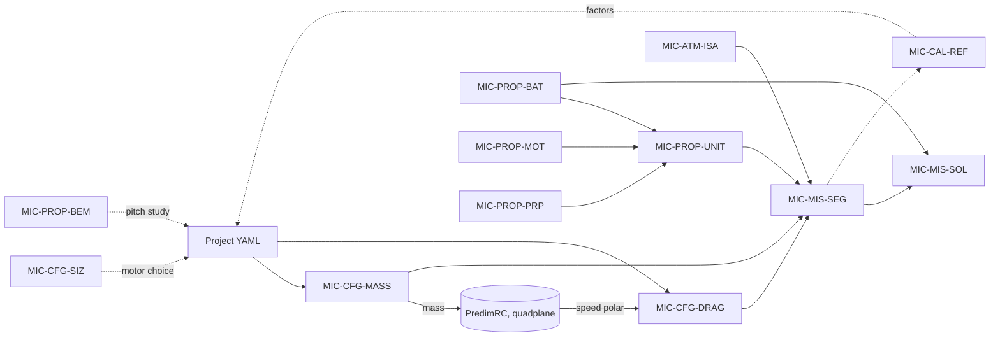

# MVP Model Identity Cards (MIC)

Every MVP model that does not come from PredimRC has a card here. PredimRC itself is
an external model used as is; its interface is described in canvas MVP-001.

## Format

Cards follow **MIC Core** (IRT SystemX / prostep ivip,
<https://mic-core.github.io/MIC-Core/main/>) with its five groups: administrative data,
purpose and objectives, subject information, implementation, verification and
validation. MIC Core does not standardise ports and parameters, so each card adds an
**Interface** section (taken from the original MIC) and a **Traceability** section.

- The **Interface** section lies between `<!-- interface:start -->` and
  `<!-- interface:end -->`. Once MVP-002 is implemented, it is **generated** from the
  `Model` declarations (`core/mic.py`) and is no longer edited by hand. Until then, the
  tables below are the target that the code must reproduce.
- The descriptive sections are written by hand and kept up to date with the code.
- Users do not edit the cards; they override parameter values in the project file.

Each parameter is described by: name, symbol, unit, description, default value or
origin, physical bounds, source.

## Common administrative data

| Attribute | Value |
|---|---|
| Release | 0.1.0-mvp |
| Release date | 2026-10-12 |
| Release type | specification (pre-release) |
| Model supplier | predimrc_wrapper — Sebastien Bocquet |
| Confidentiality level | 0 — public |
| Legal restriction | LGPL-3.0 (code); data from cited public sources |
| Environment | Python ≥ 3.10, numpy, scipy; no Excel |

## Cards

| Identifier | Model | Canvas |
|---|---|---|
| [MIC-ATM-ISA](MIC-ATM-ISA.md) | ISA atmosphere | MVP-003 |
| [MIC-PROP-BAT](MIC-PROP-BAT.md) | Battery pack | MVP-003 |
| [MIC-PROP-MOT](MIC-PROP-MOT.md) | Brushless motor, 3 constants | MVP-003 |
| [MIC-PROP-PRP](MIC-PROP-PRP.md) | Propeller, momentum theory (MVP) | MVP-003 |
| [MIC-PROP-BEM](MIC-PROP-BEM.md) | Propeller, blade elements with momentum inflow (pitch study) | to write |
| [MIC-PROP-SUR](MIC-PROP-SUR.md) | Thrust–power surrogate, physics × Gaussian process | INC2-003 |
| [MIC-PROP-CHAIN](MIC-PROP-CHAIN.md) | Power chain battery – cables – ESC – cables – motors | INC2-004 |
| [MIC-MIS-TWO](MIC-MIS-TWO.md) | Two-phase flight time (hover, cruise at target speeds) | INC2-007 |
| [MIC-MIS-BUDGET](MIC-MIS-BUDGET.md) | Power budget: power sinks per phase | INC3-002 |
| [MIC-COST](MIC-COST.md) | Purchase cost and cost of use | INC3-004 |
| [MIC-REL](MIC-REL.md) | Motor-out hover (redundancy) | INC3-004 |
| [MIC-PROP-UNIT](MIC-PROP-UNIT.md) | Propulsion unit, constant ESC efficiency (MVP) | MVP-003 |
| [MIC-CFG-MASS](MIC-CFG-MASS.md) | Mass budget | MVP-004 |
| [MIC-CFG-DRAG](MIC-CFG-DRAG.md) | Parasitic drag and drag polar | MVP-004 |
| [MIC-MIS-SEG](MIC-MIS-SEG.md) | Segment powers | MVP-005 |
| [MIC-MIS-SOL](MIC-MIS-SOL.md) | Mission integration and optimal speeds | MVP-005 |
| [MIC-CFG-SIZ](MIC-CFG-SIZ.md) | Motor power law (pre-selection from a target mass) | to write |
| [MIC-CAL-REF](MIC-CAL-REF.md) | Calibration on measured hover and cruise points (procedure) | to write |

## Model chain

