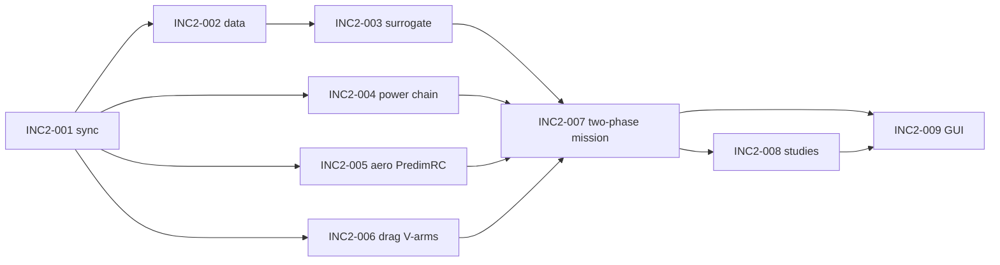

# predimrc_wrapper — Increment 2: the designer's workflow in one GUI

The MVP (`mvp/`) computes the flight time with its own mission solver (segment
scenarios, momentum-theory hover). The designer does not adopt it as is: it is too far
from the way he computes a flight time today. Increment 2 reproduces **his process**, in
one GUI, and improves each step. Requirement identifiers are those of the full
specification (`docs/requirements/`); this folder holds the increment statements and the
REASONS canvases.

Status: **specification, not implemented** (2026-10-14). Canvas INC2-001 records what was
coded on 2026-10-12/13 after the MVP (to be kept or reworked by the other canvases).

## The designer's process today (as-is)

1. **Hover.** From the mass and the balance of moments about the CG, the thrust of each
   motor. In the thrust–power test data of the motor / propeller pair, interpolate the
   point at that thrust: electric power and power margin of each motor.
2. **Cruise.** In PredimRC, read the aerodynamic power versus speed curve; take two
   target speeds near its minimum and the power at those speeds.
3. **Flight time.** With a 20 % battery reserve: hover time at the hover power, the rest
   of the energy in cruise at each target speed.

## Target process (to-be)

The same three steps, in one Streamlit GUI, with:

| Improvement | Requirement | Canvas |
|---|---|---|
| Thrust–power interpolation by a physics-based Gaussian-process surrogate with an error guarantee, to explore configurations not tested | REQ-PROP-011, REQ-NFR-005 | INC2-003 |
| The data behind every power value shown; surrogate validation | REQ-PROP-012 | INC2-003, INC2-009 |
| Thrust–power test data, propellers and flight test points stored with provenance | REQ-DATA-002, -005, -006 | INC2-002 |
| Aircraft configuration tab (editable name): quadplane, tricopter, multicopter, choice of the tilting motor(s) | REQ-CFG-001, -002, REQ-UI-008 | INC2-009 |
| Thrust per motor from the moment balance; front / rear thrust ratio shown | REQ-CFG-010 | INC2-007 |
| Two-phase flight time (hover + cruise at two target speeds, 20 % reserve) | REQ-MIS-008 | INC2-007 |
| Cruise tab with the PredimRC layout: geometry and aerodynamic power versus speed | REQ-AERO-008, REQ-UI-008 | INC2-005, INC2-009 |
| Aerodynamic power curve identical to PredimRC (iso-model check) | REQ-AERO-011 | INC2-005 |
| PredimRC workbook chosen by folder and profile name (one file per airfoil) | REQ-AERO-009 | INC2-005 |
| PredimRC accessory drag set to zero (no double counting) | REQ-AERO-006 | INC2-005, INC2-006 |
| Drag tab: V-shaped motor arms under the fuselage, model shown per source | REQ-CFG-004 | INC2-006 |
| Power chain battery – cables – ESC – cables – motors, losses per segment, cable lengths defaulted from the geometry | REQ-PROP-009 | INC2-004 |
| Propeller sizing tab: optimal pitch for the two target speeds | REQ-PROP-007 | INC2-009 |
| Test data tab: measured hover and cruise points (optional), model versus measurement | REQ-DATA-006, REQ-NFR-007 | INC2-002, INC2-009 |
| Exploration of configurations | REQ-MDO-007 | INC2-008 |
| Optimisation, optionally over motors and propellers (categorical) | REQ-MDO-008 | INC2-008 |
| Analyses (explorations, optimisations) stored and reloaded | REQ-MDO-009 | INC2-008 |
| MIC cards page in the sidebar | REQ-UI-009 | INC2-009 |
| Every quantity defined by a help in the GUI (definition, symbol, unit, default and its source, model card) | REQ-UI-010 | INC2-009 |

## Definition of done

1. The designer's tricopter (1870 g, 12 in front / 10 in rear propellers) is entered in the
   GUI with its CG; the GUI shows the thrust of each motor, the front / rear thrust ratio,
   the hover power of each motor read from the surrogate with its 95 % interval and the
   test points around it, and the hover power margin.
2. With the 280 W measured in hover entered in the Test data tab, the model–measurement
   deviation is shown; the surrogate prediction lies within its stated interval.
3. A quadplane 4+1 built on `tricoptere_short_2`: the Cruise tab shows the PredimRC
   geometry and aerodynamic power curve, the iso-model check passes (≤ 1e-6 relative to
   the PredimRC sheet), and the two target speeds give two cruise battery powers.
4. The flight time with 20 % reserve is given for each target speed, and matches a hand
   calculation from the displayed hover and cruise powers to 0.1 %.
5. The power chain tab gives the losses of each segment at hover and at each target
   speed; the cable lengths default from the geometry and can be edited.
6. An exploration (motor × propeller × battery mass) and an optimisation run from the
   GUI, are saved, reloaded in a new session and compared.
7. The MIC cards of every model used open from the sidebar.
8. Every input and every displayed quantity (fields, table columns, KPI tiles, chart
   axes) has a help giving its definition, symbol, unit and, for an input, its default
   and the source of that default; a test fails when a quantity has no help entry.

## Work packages (in order)

| Canvas | Package | Exit criterion |
|---|---|---|
| INC2-001 | [Sync] post-MVP code of 2026-10-12/13 | canvas matches the code; tests pass (149) |
| INC2-002 | [Feat] data — propellers, thrust–power tests, flight test points | files load with provenance; CSV import round trip |
| INC2-003 | [Feat] prop — thrust–power surrogate (physics + GP) | LOO coverage of the 95 % interval in [90 %, 99 %]; interpolation error ≤ 3 % on held-out points |
| INC2-004 | [Feat] prop — power chain and cables | losses sum exactly; defaults from geometry |
| INC2-005 | [Feat] aero — PredimRC profiles, iso-model curve, accessories off | iso-model test passes on the reference case |
| INC2-006 | [Feat] cfg — drag sources with V-arms | V-arm frontal area and drag checked by hand calculation |
| INC2-007 | [Feat] mission — two-phase flight time | DoD 1, 3, 4 |
| INC2-008 | [Feat] mdo — exploration, optimisation, study storage | DoD 6 |
| INC2-009 | [Feat] ui — workflow tabs, propeller sizing, test data, MIC page, help on every quantity | DoD 1–8 in the GUI |

## Decisions taken (2026-10-14)

- The **two-phase evaluation** (hover + cruise at target speeds) becomes the main result.
  The MVP segment scenarios stay available as an advanced mode and are not extended.
- Hover power comes from **test data through the surrogate**; the momentum-theory model
  (figure of merit) remains only as the physics mean of the surrogate and as a fallback,
  flagged, when no data covers a motor / propeller pair.
- Cruise aerodynamics come **only** from PredimRC (wing-borne) plus the tool's drag
  sources; the PredimRC accessory surface is forced to 0.
- The cruise propeller efficiency comes from the blade-element model (MIC-PROP-BEM) at
  the propeller pitch, or from coefficient data when they exist (REQ-PROP-004); the
  constant η_c of the MVP is a fallback.
- Surrogate library: scikit-learn `GaussianProcessRegressor` (already installed with
  `gemseo[all]`), fitted models cached on disk by data hash.
- Every power shown is traceable to its source: test points, surrogate (mean, σ) or
  physics model.
- Language: English; GUI labels in English, PredimRC labels kept verbatim in the Cruise
  tab.

### Answers of the designer (2026-10-14)

1. **Target speeds:** V₁ = minimum aerodynamic power speed, V₂ = maximum lift-to-drag
   speed by default, both editable. They are written into the PredimRC "Performances à
   vitesse imposée" inputs Vx 1 / Vx 2 (`3-Geometrie!AB29`, `AB30`, km/h) so that the
   PredimRC sheet and the tool show the same two speeds.
2. **Reserve:** energy available = **80 % of the nominal energy** (definitions below).
3. **Thrust–power data:** manufacturer tables from the internet only (no bench planned).
   - A table that does not name an ESC: power taken as measured **at the motor input**
     (`measured_at = motor_input`); the ESC and all cables are added by the power chain.
   - A table that names the ESC used for the test: power measured **at the ESC input**
     (`measured_at = esc_input`); the ESC loss is accounted for with the MVP model
     (constant ESC efficiency, default 0.95): it is inside the table power, shown as a
     segment of the chain, and the motor input power is P_table · η_esc; it is not added
     a second time.
   - CSV import of a bench is kept as a Could.
4. **Error guarantee:** 95 % interval; trusted when σ_rel ≤ 5 %.
5. **ESC:** lift motors with a **4-in-1** ESC or **separate** ESCs (choice); cruise motor
   with a separate ESC. Positions entered by the user: cruise ESC and 4-in-1 ESC in % of
   the fuselage length; separate lift ESCs in % of the arm length (multicopter,
   tricopter); for the quadplane 4+1, every ESC in % of the fuselage length. The main
   cable starts **downstream of the battery** (at its rear end, connector side); the
   battery itself carries no cable length.
6. **Drag shapes:** one C_d per shape as in PredimRC ("Profilé", "Mixte",
   "Non profilé", `Calculs1!D169:D171`). "Non profilé" C_d = 1.0 (checked:
   `Calculs1!AC3` = 0.0195 = 1.0 × 0.6 dm² / 30.8 dm²); the two others are read the same
   way from the workbook during INC2-005 and recorded with their cell as source.
7. **PredimRC layout:** screenshot received (page `3-Geometrie`), reproduced in INC2-009.
8. **Studies:** root folder chosen in the GUI (default: current working directory); one
   unique dated sub-folder per study.

### Battery energy, usable energy and reserve (decision: 80 % of nominal)

- **Nominal energy** E_nom = n_s · V_nom · C (e.g. 4S LiPo 4000 mAh: 4 × 3.7 V × 4 Ah =
  59.2 Wh). It is what the pack label gives.
- **Usable energy** E_use = f_u · E_nom: the part that can really be drawn before the
  cut-off voltage under load (voltage sag, cell spread, ageing). The MVP takes
  f_u = 0.85 (LiPo), 0.90 (Li-ion). The MVP reserve of 20 % is then taken on E_use:
  energy available = 0.80 × 0.85 = 68 % of E_nom.
- **Decision (2026-10-14):** the two-phase evaluation uses energy available =
  (1 − 0.20) · E_nom = 80 % of the nominal energy (the usable fraction f_u is not
  applied); E_nom and the energy available are displayed with the flight time. The
  MVP scenario mode keeps its own rule.

## Open questions

None at this stage.

## Out of increment 2

Transition and climb modelling, wind, multi-scenario evaluation, battery sizing mode,
Excel pool, PredimRC derived `cz_reg`, coaxial motors, ESC thermal model, cost.
