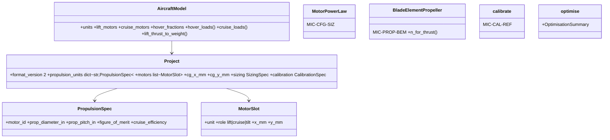

# Post-MVP code (sync)

## Requirements

- Record what was coded after the MVP, so that the specification matches the code
  before increment 2 changes it. 149 tests pass (2026-10-13, Excel tests included).
- Boundary: nothing new to code; the "Fate in increment 2" column of Operations says
  what later canvases keep, change or retire.

## Entities

## Approach

1. Project format 2: named propulsion unit types and an explicit motor list (position,
   unit type, role lift / cruise / tilt); format 1 migrated on load (`migrate_v1`).
2. Hover thrust split `hover_thrust_split`: min Σ T_i²/A_i under force and, with a CG,
   moment balances; disc-area split without CG; CG outside ⇒ `ProjectError`.
3. Segment powers per motor (heterogeneous), worst margins over motors; tilt motors lift
   and cruise; mass counts each motor once (categories lift / cruise / tilt propulsion).
4. Sizing law (MIC-CFG-SIZ), calibration (MIC-CAL-REF), blade-element propeller
   (MIC-PROP-BEM) with pitch study charts, optimisation loop `mdo/optimise.py` and GUI
   tab; `mission.drag_factor`.
5. GUI: configuration selector applied immediately (bug fix), tabs Sizing, Propulsion
   and motors (layout generator), Calibration, Geometry (roles, V-tail, CG), Propulsion
   charts (thrust/power curves, pitch study), Results (aero, shaft, battery power),
   Optimisation.

## Structure

### Layered Architecture
1. `aircraft/project.py` (schema v2), `aircraft/layouts.py`, `aircraft/model.py`,
   `mission/powers.py`, `mission/solver.py` (sweep with drag and shaft power),
   `propulsion/propeller.py` (BEM), `sizing.py`, `calibration.py`, `mdo/optimise.py`,
   `ui/app.py`, `ui/geometry.py`, `ui/propulsion_charts.py`, `ui/optimisation.py`.
2. Data: `data/motors_mvp.yaml` (5 motors 150–250 W); templates `multicopter`,
   `tricopter`, `quadplane`, `tiltrotor`.

## Operations

| Item | Files | Fate in increment 2 |
|---|---|---|
| Motor list, roles, layouts, migration | `aircraft/project.py`, `layouts.py` | kept; tilt choice moves to the Aircraft configuration tab (INC2-009) |
| Hover split with CG | `aircraft/model.py` | kept; front / rear ratio added (INC2-007) |
| Hover power by momentum theory + FM | `mission/powers.py` | becomes the physics mean and the fallback of the surrogate (INC2-003) |
| Cruise power with constant η_c | `mission/powers.py` | replaced by BEM / data η (INC2-007); constant η_c fallback |
| Segment scenarios | `mission/` | kept as advanced mode, not extended |
| Sizing law | `sizing.py` | kept (Aircraft configuration tab) |
| Calibration | `calibration.py` | moved to the Test data tab, applied to the two-phase evaluation (INC2-009) |
| BEM propeller, pitch study | `propulsion/propeller.py`, `ui/propulsion_charts.py` | kept; Propeller sizing tab for V₁, V₂ (INC2-009) |
| Optimisation loop and tab | `mdo/optimise.py`, `ui/optimisation.py` | kept; two-phase objectives and study storage (INC2-008) |
| `gemseo[all]` extra | `pyproject.toml` | kept; pin `xlwings>=0.37` (gemseo[all] downgrades it to 0.33) |

## Norms

1. Format-1 project files keep loading.
2. Motor data copied from manufacturer pages only.

## Safeguards

1. The 149 tests of 2026-10-13 keep passing until a canvas explicitly retires a behaviour.
2. The MIC Interface sections stay generated from the code.

## Implementation notes (2026-10-14)

- `pyproject.toml`: `xlwings >=0.37` pinned, `scikit-learn`, `joblib` added (INC2-003),
  thrust-test files packaged.
