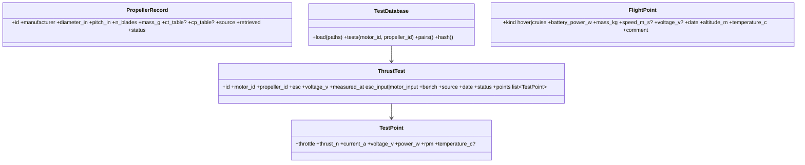

# Propellers, thrust–power tests, flight test points

## Requirements

- Store the data the designer interpolates in: thrust–power tests of motor + propeller
  pairs, with the electrical point of measurement; a propeller database; the flight test
  points of a project.
- Every row is traceable (source, date, bench, status). Values are copied, never
  invented.
- Boundary: no surrogate here (INC2-003); no download from the internet at run time.

## Entities

## Approach

1. Files: `data/propellers.yaml` (list of `PropellerRecord`); `data/thrust_tests/*.yaml`
   (one `ThrustTest` per file); user folder (setting, default
   `~/.predimrc_wrapper/data/`) merged with the shipped data, a user id overriding a
   shipped one with a warning.
2. CSV import: columns `throttle, thrust_g|thrust_n, current_a, voltage_v, power_w,
   rpm[, temperature_c]` + a header form (motor, propeller, ESC, voltage, measured_at,
   bench, source, date); converted to SI and written as a YAML `ThrustTest` in the user
   folder.
3. `measured_at` follows the table (designer's rule, 2026-10-14): the table names the
   ESC used for the test ⇒ `esc_input` (the ESC is recorded in `esc`; its loss is
   accounted for with the MVP constant-efficiency model); no ESC named ⇒ `motor_input`
   (ESC and cables added by the power chain). The loader derives the default from
   `esc` and the user can override it. Used by the power chain (INC2-004) to avoid
   counting the ESC twice.
4. Shipped thrust tests: the manufacturer tables published on the internet for the
   database motors with their recommended propellers (T-Motor pages, copied as for the
   motors). No bench is planned: the CSV import (step 2) is a Could.
5. Flight test points: `test_data: list[FlightPoint]` in the project (replaces the
   `calibration` block; migration: hover / cruise reference → two points).
6. `TestDatabase.hash()` (content hash) recorded with results and studies.

## Structure

### Dependencies
1. `data/database.py` (motors) extended with `PropellerDatabase`, `TestDatabase`;
   `aircraft/project.py` gains `test_data`, `PropulsionSpec.propeller_id` (optional,
   else diameter / pitch / mass).

### Layered Architecture
1. `data/propellers.py`, `data/tests.py`, `data/importers.py` (CSV).

## Operations

### Create - `src/predimrc_wrapper/data/tests.py`
1. Dataclasses above; loader validating units, monotonic throttle, positive thrust and
   power, required provenance and `measured_at` (else `DatabaseError` naming the file).
2. `TestDatabase.load(shipped, user)`, `tests(motor_id, propeller_id=None, voltage=None)`,
   `pairs()`, `hash()`.

### Create - `src/predimrc_wrapper/data/importers.py`
1. `import_csv(path, header) -> ThrustTest`; thrust in g converted with g = 9.81;
   `write_user_test(test)`.

### Create - `src/predimrc_wrapper/data/propellers.py` + `propellers.yaml`
1. APC / T-Motor propellers covering 8–15 in used by the templates; C_T, C_P(J) tables
   where the manufacturer publishes them.

### Update - `aircraft/project.py`
1. `FlightPoint`, `Project.test_data`, migration of `calibration`.

### Create tests - `tests/data/`
1. Loader rejects missing provenance / `measured_at`; CSV round trip; merge and
   override warning; hash changes with the content.

## Norms

1. SI in memory, user units (g, in, mAh) only in files and GUI.
2. One file per test; file names `<motor_id>__<propeller_id>__<voltage>v.yaml`.

## Safeguards

1. No invented value: a missing column stays missing (NaN), never filled.
2. The shipped files are never modified by an import.

## Implementation notes (2026-10-14)

- Implemented: `data/propellers.py` + `propellers.yaml` (5 propellers of the shipped
  tests; masses not published, left empty), `data/tests.py` (`ThrustTest`,
  `TestDatabase`, content hash), 8 manufacturer tables in `data/thrust_tests/` (84 points),
  `data/importers.py` (CSV import, Could), `data/user.py` (`$PREDIMRC_USER_DATA`),
  `PropulsionSpec.propeller_id`, `Project.test_data` (`FlightPoint`).
- `measured_at` derived from `esc`: none of the shipped tables names an ESC ⇒
  `motor_input`. The tables give power = voltage × current (DC side).
- Deviation: the `calibration` block is kept next to `test_data` until INC2-009 moves the
  calibration to the Test data tab (no migration yet).
- Tests: `tests/data/test_test_data.py`.
