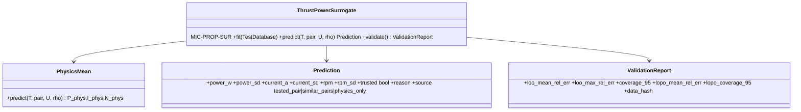

# Thrust–power surrogate

## Requirements

- Replace the designer's manual interpolation in thrust–power tables by a surrogate that
  (a) interpolates within a tested motor + propeller pair, (b) predicts untested pairs
  from tested ones to explore configurations, (c) gives a standard deviation with every
  prediction and flags the untrusted ones.
- Outputs per motor at a thrust T and voltage U: electric power P (at the test
  `measured_at` point), current I, rotation speed N, each with σ.
- Boundary: static (hover) conditions; cruise uses BEM / coefficient data (INC2-007).

## Entities

## Approach

1. **Physics mean.** For a pair (motor constants Kv, R_m, I₀; propeller D, pitch) and
   thrust T: the BEM propeller (MIC-PROP-BEM) gives rotation speed and shaft power, the
   motor model (MIC-PROP-MOT) current and electric power; ESC efficiency added when
   `measured_at = esc_input`. Without pitch: momentum theory with FM.
2. **Correction.** Gaussian process on the log ratio r = ln(P_test / P_phys) (same for
   I and N), inputs x = (T / T_ref, U / U_ref, D, P/D, Kv·U, R_m, I₀) normalised;
   kernel Matérn 5/2 with automatic relevance determination + white noise (bench
   noise); hyperparameters by maximum likelihood (scikit-learn
   `GaussianProcessRegressor`, `normalize_y`). Prediction P = P_phys·exp(μ_r),
   σ_P ≈ P·σ_r (log-normal); 95 % interval P·exp(±1.96 σ_r).
3. **Trusted domain.** A prediction is trusted when σ_r ≤ setting (default 0.05) and T
   ≤ max tested thrust of the pair (tested pair) or within the convex hull of the tested
   inputs (untested pair). Otherwise `trusted = False` with the reason; values remain
   available, shown hatched in the GUI, and usable as an optimisation constraint.
4. **No data for the pair's motor and propeller family:** `source = physics_only`,
   σ from the global validation error, flagged "no test data".
5. **Validation (error guarantee).** Leave-one-out on points and leave-one-pair-out:
   mean / max relative error, empirical coverage of the 95 % interval; report stored with
   the data hash; thresholds: coverage in [90 %, 99 %], LOO mean error ≤ 3 %. Failing
   thresholds shown as a warning in the GUI (not an error).
6. Fitted models cached on disk (`joblib`) by test-data hash; refit when data change.
7. Thrust margin: 1 − T / T_max,test of the pair (T_max from data, physics beyond).

## Structure

### Inheritance Relationships
1. `ThrustPowerSurrogate(Model)` with `mic_id = "MIC-PROP-SUR"` (inputs thrust_n,
   battery_voltage_v, rho; outputs power_w, power_sd, current_a, rpm, trusted).

### Dependencies
1. `data/tests.py` (INC2-002), `propulsion/propeller.py` (BEM), `propulsion/motor.py`;
   scikit-learn (core dependency), joblib.

### Layered Architecture
1. `propulsion/surrogate.py` (physics mean, GP, prediction, validation);
   `propulsion/surrogate_cache.py`.

## Operations

### Create - `src/predimrc_wrapper/propulsion/surrogate.py`
1. `PhysicsMean.predict(T, pair, U, rho)` vectorised.
2. `ThrustPowerSurrogate.fit(db)`, `predict(...) -> Prediction`, `validate() ->
   ValidationReport`, `points_near(pair, T, k=8)` for the GUI (REQ-PROP-012).
3. Expected forms: physics-only for an empty database equals PhysicsMean; at a tested
   point the mean is within 2σ of the measurement; σ grows outside the tested range.

### Create card - `mvp/docs/models/MIC-PROP-SUR.md`
1. Modelling choices, limitations (static only, ESC of the test), validation criteria.

### Create tests - `tests/propulsion/test_surrogate.py`
1. Synthetic data from a known model + noise: coverage ≈ 95 %, LOO error ≤ noise level.
2. Shipped data: thresholds of Approach 5.
3. Untrusted beyond max thrust; physics-only flag; cache reused by hash.

## Norms

1. The surrogate never returns a value without its σ and its source.
2. Random seeds fixed for reproducibility.

## Safeguards

1. No silent extrapolation: every untrusted value is flagged in results and studies.
2. The physics mean alone must already be within ±25 % of the data (sanity test), so
   that the GP corrects a reasonable model.

## Implementation notes (2026-10-14)

- Implemented: `propulsion/surrogate.py` (`physics_mean`, `ThrustPowerFit`,
  `ThrustPowerSurrogate` = MIC-PROP-SUR, `Prediction`, `ValidationReport`); card
  `MIC-PROP-SUR.md`; tests `tests/propulsion/test_surrogate.py`.
- Validation on the shipped data (84 points, 8 pairs): LOO mean error 0.8 %, coverage
  95.2 %; leave-one-pair-out 1.7 %, coverage 97.6 %; physics mean alone 4.5 %.
- Changes found necessary on the data: the physics current is the supply current P / U
  (the tables give U·I on the DC side), and the post-stall drag of MIC-PROP-BEM is set to
  c_d,s = 0.5, fitted on the 8 tables (was 1.5, unsourced; the APC pairs were 30–40 %
  off).
- Deviation: fit cached in memory by data hash (2.5 s), no disk cache (joblib) — not
  needed at this data size.
