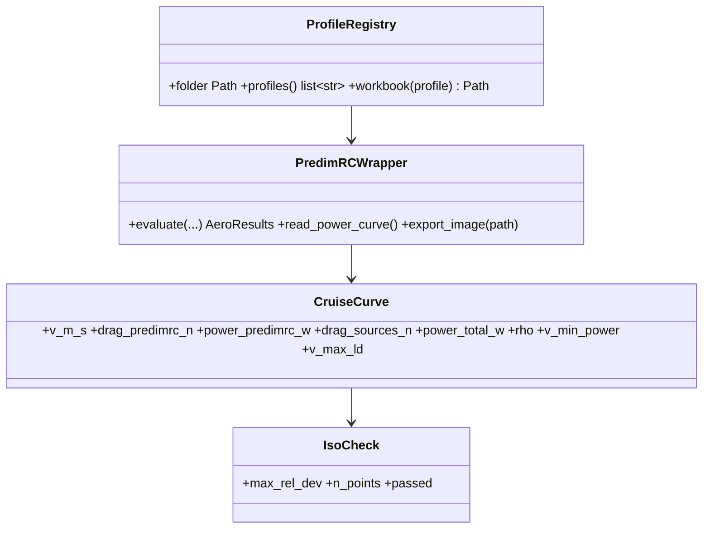

# PredimRC profiles and iso-model cruise curve

## Requirements

- Open the PredimRC workbook of the profile chosen by name in a user folder.
- Give the aerodynamic power versus speed curve and its two target speeds, identical to
  PredimRC (iso-model check shown), plus the tool's drag sources.
- Force the PredimRC accessory surface to 0 so that drag is not counted twice.
- Provide what the Cruise tab needs to reproduce the PredimRC layout (inputs table,
  plan view data, curve; optional image export).

## Entities

## Approach

1. Settings (outside the project file, user settings file): `predimrc_folder`; project:
   `aero.profile` (free text, validated against `ProfileRegistry.profiles()` of the
   folder). Convention `PredimRC_<profile>.(xls|xlsx|xlsm)`; several matches ⇒ error.
2. Before each evaluation, write accessory surface = 0 (shape untouched). Project
   migration: `accessory_area_dm2 > 0` ⇒ a `cds` drag source with the same equivalent
   CdS (PredimRC shape coefficient) and a warning; the field is removed from the schema.
3. `CruiseCurve` from the PredimRC sheet columns (speed, drag, power) read after
   evaluation, at the PredimRC density; tool drag sources added at the same density;
   rescaling to the flight altitude by equal dynamic pressure (existing).
4. Atmosphere: the flight altitude and temperature of the project are written into
   `3-Geometrie!T29` (Altitude, m) and `T30` (Temp., °C); the PredimRC density is read
   back in `U30` and used for the curve (no rescaling needed when they agree; checked).
5. Target speeds: V₁ = speed of minimum power, V₂ = speed of maximum L/D of the
   *total* curve (with drag sources), parabolic refinement; both overridable; written
   into `3-Geometrie!AB29` (Vx 1, km/h) and `AB30` (Vx 2) before the recalculation, so
   that the PredimRC blocks "vitesse imposée" (`Calculs1` rows 61–75 for V1, 76–90 for
   V2) are computed at the same speeds.
6. Iso-model check, two levels: (a) curve — `power_predimrc_w` versus the PredimRC
   level-flight columns cell by cell (|Δ|/P ≤ 1e-6) and versus D·V; (b) target speeds —
   the tool's aerodynamic power at V_k versus the PredimRC "vitesse imposée" power at
   the trimmed C_z = 2mg / (ρ S V_k²), interpolated in the V_k block (≤ 1e-6 relative,
   or the interpolation error bound when the C_z grid is coarse); result attached to the
   curve and shown.
7. Shape drag coefficients (used by INC2-006): for each accessory shape label of
   `Calculs1!D169:D171` ("Profilé", "Mixte", "Non profilé"), set the shape with a known
   accessory surface S_acc on a scratch copy, read `Calculs1!AC3` (Cx acc., referred to
   the wing area S_ref) and record C_d = Cx_acc · S_ref / S_acc, with the cell as
   source, in `data/drag_shapes.yaml` (one-off extraction script, result committed).
   Already checked: "Non profilé" C_d = 1.0.
8. Layout data for the Cruise tab: the PredimRC input groups (wing panels, stabiliser,
   fuselage, Réglages) and output blocks (wing and stabiliser results, CG, foyer,
   masses, wing loading) as tables with PredimRC labels, plan view from `ui/geometry`,
   the level-flight and imposed-speed curves (INC2-009 arrangement).
9. Optional `export_image(path)`: copy of the PredimRC drawing chart as PNG (xlwings
   `Chart.to_png`), cached by geometry hash.

## Structure

### Dependencies
1. `predimrc_wrapper.py` (MVP-001) extended; `aircraft/aero.py` returns `CruiseCurve`;
   `api.profiles_dir` replaced by `ProfileRegistry` + settings.

### Layered Architecture
1. `aero/profiles.py` (registry, settings), `aero/cruise_curve.py` (curve, iso check,
   target speeds).

## Operations

### Update - `src/predimrc_wrapper/predimrc_wrapper.py`
1. `template_dir` → `ProfileRegistry`; accessory cell forced to 0; altitude,
   temperature, Vx 1, Vx 2 written; `read_power_curve()` returning the level-flight
   columns and `read_imposed_speed(k)` the V1 / V2 blocks; `export_image`.

### Create - `tools/extract_drag_shapes.py` + `src/predimrc_wrapper/data/drag_shapes.yaml`
1. One-off extraction of the shape C_d (Approach 7), with the workbook hash.

### Create - `src/predimrc_wrapper/aero/cruise_curve.py`
1. `cruise_curve(results, sources, rho) -> CruiseCurve`; `iso_check(curve, sheet) ->
   IsoCheck`; `target_speeds(curve) -> (V₁, V₂)`.

### Create tests
1. Registry on a temporary folder (several profiles, unknown, duplicates).
2. Slow: iso check passes on `tricoptere_short_2`; accessory cell reads 0 after a run
   with a non-zero accessory input; migration of `accessory_area_dm2`.
3. Fast: with sources, ΔP = ½ρV³ΣCdS exactly; target speeds of a parabolic polar equal
   the analytic ones (V_minP = V_maxL/D / 3^0.25).

## Norms

1. PredimRC labels kept verbatim in the Cruise tab.
2. The density used is always displayed with the curve.

## Safeguards

1. The template workbooks are never modified (REQ-AERO-002 still applies).
2. The iso check failing is shown in red and recorded in results and studies.

## Implementation notes (2026-10-14)

- Implemented: `discover_profiles` / `workbook_path` (no `ProfileRegistry` class),
  `settings.py` (PredimRC folder, studies root; `$PREDIMRC_PROFILES` overrides),
  `Settings` of the wrapper with altitude, temperature, Vx 1, Vx 2 (T29, T30, AB29,
  AB30), `AeroResults.power_predimrc_w` (Calculs1!AQ5:AQ30) and `imposed` (V1 / V2
  blocks rows 62–75, 77–90: Cz B, Rx (N) AK, P (W) AQ); `aircraft/cruise.py`
  (`CruiseCurve`, `TargetPoint`, `IsoCheck`, `target_points`); accessory forced to 0 and
  migrated to a `cds` source (`migrate_accessory`), `AeroSpec.profile` free text.
- The power at V₁, V₂ is PredimRC's imposed-speed value at the trimmed C_z (the
  interpolated polar differs by up to 2 %: coarse grid). Speeds rounded to 0.01 km/h
  before writing so that both sides use the same speed.
- Iso checks on the reference case: curve 2e-16, imposed speeds 0 (slow test).
- Shape C_d extracted (`tools/extract_drag_shapes.py`, cell `Calculs1!AD3`, not AC3
  which holds the label): Profilé 0.2, Mixte 0.6, Non profilé 1.0.
- Not done: PredimRC image export (Could).
