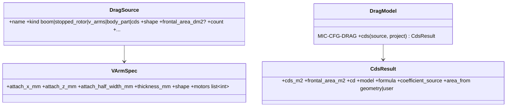

# Drag sources and V-arms

## Requirements

- Add the V-arm variant: motor arms attached under the fuselage, going diagonally (a V
  seen from the front) to the motors, for quadplane, tricopter and multicopter.
- As in PredimRC, describe a source by a shape (more or less aerodynamic) and a frontal
  area, the area defaulting to the value derived from the geometry.
- Show for each source the model used (formula, coefficients and their sources) and its
  CdS; the PredimRC accessory drag is off (INC2-005).

## Entities

## Approach

1. V-arm geometry: one arm per motor of the list `motors` (default: all lift motors),
   from the attachment point (x_a, ±w_a/2, z_a under the fuselage; defaults: wing root
   quarter chord or frame centre, fuselage half-width, −fuselage height / 2) to the
   motor (x_i, y_i, z_m). Arm vector u, length L_i.
2. Frontal area projected on the plane normal to the flow: A_i = t·L_i·√(1 − u_x²)
   (beam of thickness t), A = Σ A_i; user override possible ("area_from = user").
3. Drag: CdS = C_d(shape)·A. Three shapes, as the PredimRC accessory shapes:
   "Profilé", "Mixte", "Non profilé", one C_d each read from `data/drag_shapes.yaml`
   (extracted from PredimRC by INC2-005, source `Calculs1!AC3`); "Non profilé" = 1.0
   (checked 2026-10-14).
4. Existing kinds kept (boom: friction + base drag; stopped rotor: blade planform; cds)
   and a generic `body_part` kind (shape + frontal area) for pods, gear, motor nacelles.
5. Every source returns `CdsResult` with the formula text and coefficient source; the
   Drag tab shows them in a table (source, kind, model, area, C_d, CdS, share of total
   drag at V₁).
6. Geometry preview draws the V-arms (top and front views).
7. A layout preset may add the V-arms source automatically (option in the generator).

## Structure

### Dependencies
1. `aircraft/project.py` (`DragSource` kinds, `VArmSpec`), `aircraft/drag.py`
   (`DragModel.cds` returns `CdsResult`), `ui/geometry.py`.

## Operations

### Update - `src/predimrc_wrapper/aircraft/drag.py`
1. `CdsResult`; `cds(source, project)` for all kinds; `SHAPES` table with coefficients
   and sources; MIC-CFG-DRAG card updated (V-arms, shapes, model display).

### Update - `aircraft/project.py`, `ui/geometry.py`
1. Schema of the new kinds with defaults from geometry; drawing of the arms.

### Create tests - `tests/aircraft/test_drag_sources.py`
1. Tricopter V-arms: lengths, frontal area and CdS equal a hand calculation; area
   follows a motor move; user area overrides; result carries formula and source.

## Norms

1. A coefficient without a cited source is not accepted in `SHAPES`.

## Safeguards

1. The same element is never in two sources (warning when a V-arm and a boom share
   motors).

## Implementation notes (2026-10-14)

- Implemented: `DragSource` kinds `v_arms`, `body_part`, fields `shape`,
  `frontal_area_dm2`, `thickness_mm`, attachment and `motors`; `aircraft/drag_sources.py`
  (`source_cds`, `drag_report`, `CdsResult`, `v_arm_segments`); V-arms drawn in both
  views; MIC-CFG-DRAG updated; tests `tests/aircraft/test_drag_sources.py`.
- Defaults: quadplane roots at the wing quarter chord, under the fuselage, at ± half its
  width; rotary frame roots at the centre, 40 mm below the motors.
