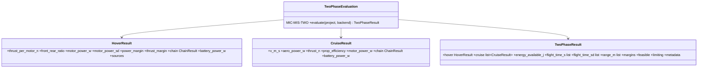

# Two-phase flight time

## Requirements

- Compute the flight time exactly as the designer does, so that it can be checked by
  hand from the displayed numbers:
  1. hover: thrust of each motor (mass, moments), electric power from the surrogate,
     power chain, hover battery power P_h and margins;
  2. cruise: aerodynamic power at V₁ and V₂ (PredimRC + drag sources), cruise
     propulsion (propeller efficiency from BEM or data, motor, chain), cruise battery
     power P_c(V_k);
  3. flight time with the reserve, per target speed.
- Give the uncertainty of the flight time from the surrogate σ.

## Entities

## Approach

1. Inputs (project `mission` block, two-phase mode default): `hover_time_s` (default
   90 s), `reserve_fraction` 0.20 of the nominal energy
   (decision 2026-10-14: available = 0.8·E_nom), `target_speeds_m_s`
   [V₁, V₂] or `auto` (min power, max L/D; written into PredimRC Vx 1 / Vx 2),
   `avionics_power_w`.
2. Hover: T_i = f_i·k_dl·m·g from `hover_thrust_split` (CG required for the designer's
   process; without CG the area split is used and flagged). Front / rear thrust ratio:
   Σ T_i (x_i < x_cg) / Σ T_i (x_i > x_cg) (undefined ⇒ not shown). Per motor: surrogate
   prediction at T_i and the battery voltage under load (iterated once with the chain);
   power margin 1 − P_i / P_max,i; thrust margin; chain (INC2-004); P_h = Σ chain input
   + avionics.
3. Cruise (wing-borne): D(V_k) total drag (INC2-005, INC2-006); thrust shared among the
   cruise and tilt motors by disc area; per motor: BEM propeller at the unit pitch (or
   C_T/C_P data) gives rotation speed and shaft power at (T, V); motor model; chain;
   P_c = Σ + avionics. Constant η_c only when no pitch nor data (flagged). Multicopter:
   forward-flight momentum model of the MVP with the surrogate for the motor power at the
   rotor thrust.
4. Energy: E_avail = (1 − r)·E_nom; t_c,k = (E_avail − P_h·t_h) / P_c,k (≤ 0 ⇒
   infeasible "hover too long"); t_k = t_h + t_c,k; range V_k·t_c,k.
5. Uncertainty: σ_t,k from σ_P_h (sum of motor σ, fully correlated by default, an
   option for independent) and σ_P_c by first-order propagation.
6. Margins: per-motor power and thrust margins, current, battery C-rate, T/W from the
   surrogate maximum thrust, maximum take-off mass, surrogate trust (any untrusted value
   ⇒ `limiting = "untrusted_surrogate"` warning, not infeasible).
7. `metadata`: data and database hashes, PredimRC profile and workbook hash, iso check,
   tool version (REQ-NFR-004).
8. API: `evaluate(project)` returns `TwoPhaseResult` by default; the MVP segment solver
   stays as `evaluate(project, mode="scenario")`; the GEMSEO discipline exposes
   `flight_time_v1`, `flight_time_v2`, `range_v1`, `range_v2`, `hover_power`,
   `cruise_power_v1/v2`, the margins and `max_sd_rel`.

## Structure

### Inheritance Relationships
1. `TwoPhaseEvaluation(CompositeModel)`, `mic_id = "MIC-MIS-TWO"`.

### Dependencies
1. INC2-003 surrogate, INC2-004 chain, INC2-005 cruise curve, INC2-006 drag,
   MIC-PROP-BEM, MIC-PROP-MOT, MIC-PROP-BAT, `hover_thrust_split`.

### Layered Architecture
1. `mission/two_phase.py`; `api.py` (mode); `mdo/discipline.py` (outputs).

## Operations

### Create - `src/predimrc_wrapper/mission/two_phase.py`
1. Dataclasses above; `TwoPhaseEvaluation.evaluate`; `to_dict()`; `hand_check()` giving
   the formula of step 4 with the numbers (shown in the Results tab).

### Create card - `mvp/docs/models/MIC-MIS-TWO.md`

### Update - `api.py`, `mdo/discipline.py`, `mdo/optimise.py` (objectives)

### Create tests - `tests/mission/test_two_phase.py`
1. Flight time equals the formula from the result's powers (1e-9).
2. t_h = 0 ⇒ cruise-only endurance; t_h too long ⇒ infeasible.
3. Tricopter with CG: thrusts balance the moments; ratio by hand; designer example
   (1870 g, hover power within the surrogate interval of the 280 W measurement —
   checked once data are shipped).
4. Quadplane with fake aero: V₁, V₂ from the curve; P_c ≥ D·V.

## Norms

1. Each power is accompanied by its source and data (for REQ-PROP-012).

## Safeguards

1. Untrusted values never silently feed an optimum: studies store the flag.
2. The scenario mode keeps its tests unchanged.

## Implementation notes (2026-10-15)

- Implemented: `mission/two_phase.py` (`TwoPhaseEvaluation` = MIC-MIS-TWO,
  `TwoPhaseResult`, `hand_check`), `api.evaluate_two_phase`, `MissionSettings.hover_time_s`
  and `target_speeds_m_s`; Results tab shows the two-phase result first (KPIs per V1 / V2,
  hand check, hover and cruise tables, chain losses), the scenario mode below
  (`ui/two_phase_view.py`); card `MIC-MIS-TWO.md`; tests `tests/mission/test_two_phase.py`.
- Reserve: 20 % of the nominal energy (designer, 2026-10-15).
- Deviation: `evaluate(project)` keeps the MVP scenario mode; the two-phase evaluation is
  `evaluate_two_phase` (the GEMSEO outputs and objectives are added in INC2-008).
- Results on the templates (uncalibrated): tricopter hover 256 W at the battery (280 W
  measured), quadplane 4+1 with PredimRC 69–72 min, iso check passed.
