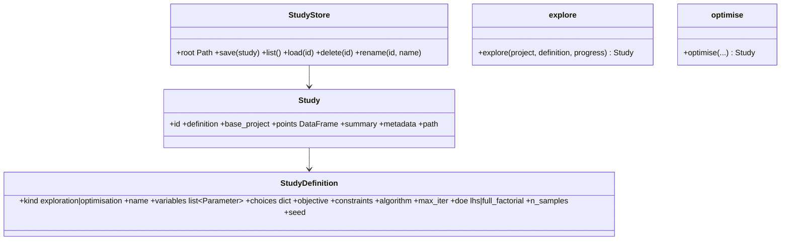

# Exploration, optimisation, studies

## Requirements

- Explore configurations (DOE over continuous variables × categorical choices: motors,
  propellers, cells, templates) with the two-phase evaluation.
- Optimise (existing loop) with two-phase objectives, propellers as categorical choices
  and an optional constraint on the surrogate uncertainty.
- Store every exploration and optimisation as a study that can be listed, reopened,
  compared and applied.

## Entities

## Approach

1. Exploration: continuous samples (Latin hypercube with fixed seed, or full factorial
   grid) × every combination of the categorical choices; evaluated sequentially (one
   PredimRC session, polar cache by geometry and mass); progress callback; failed
   points kept with their error.
2. Outputs per point: inputs, all discipline outputs, σ, trust flags, feasibility,
   limiting reason. Views: table, scatter of any output against any input with colour by
   choice, feasible points, Pareto front (default flight time V₂ versus total mass),
   parallel coordinates.
3. Optimisation: existing `mdo/optimise.py` with objectives `flight_time_v1`,
   `flight_time_v2`, `range_v2`, `mass_total`; constraint `margin_sd = s_max − max σ_rel`
   optional; categorical propellers from the propeller database (diameter compatible
   with the layout); history kept per evaluation.
4. Storage: root folder chosen in the GUI (setting, default the current working
   directory), one unique dated sub-folder per study
   `<root>/<YYYYMMDD-HHMMSS>-<kind>-<slug>/` (suffix `-2`, `-3` if it exists): `study.yaml`
   (definition + base project embedded), `points.csv`, `summary.json`, `metadata.json`
   (tool version, database, test-data and PredimRC workbook hashes, profile, date).
   Studies are immutable; rename edits `study.yaml` only.
5. Compare: overlay of two studies on the same axes; apply: overrides of a selected
   point applied to the project (validation shown before applying).

## Structure

### Dependencies
1. `mission/two_phase.py`, `mdo/discipline.py`, `mdo/optimise.py`, GEMSEO DOE (pyDOE3
   via `gemseo[all]`) or a local LHS.

### Layered Architecture
1. `mdo/explore.py`, `mdo/studies.py` (store, I/O), `mdo/optimise.py` (returns a
   `Study`).

## Operations

### Create - `src/predimrc_wrapper/mdo/explore.py`, `mdo/studies.py`
1. `explore(project, definition, backend, progress) -> Study`; `pareto_mask(points,
   objectives)`.
2. `StudyStore` with atomic writes (temporary folder then rename).

### Update - `mdo/optimise.py`
1. Two-phase objectives, propeller choices, σ constraint, returns `Study`.

### Create tests - `tests/mdo/test_studies.py`
1. 2 × 2 × 5 exploration ⇒ 20 rows; Pareto mask non-dominated; save / list / load in a
   new store instance gives equal tables; metadata keys present; apply reproduces the
   point outputs.

## Norms

1. A study is reproducible from its folder alone (base project embedded, hashes).

## Safeguards

1. A study is never overwritten; a failed run still saves its points with the error.
2. Data or database hash different from the current one ⇒ the study is shown "data
   changed since".

## Implementation notes (2026-10-15)

- Implemented: discipline `mode="two_phase"` (outputs `OUTPUTS_TWO_PHASE`: flight times,
  ranges, speeds, powers, front / rear ratio, margins, `max_sd_rel`; calibration block not
  applied), `expand_overrides` (categorical `propulsion_units.<unit>.propeller` sets id,
  diameter and pitch), `mdo/explore.py` (`samples` LHS with scipy / full factorial,
  `explore`, `pareto_mask`, `study_from_optimisation`), `mdo/studies.py` (`StudyStore`:
  unique dated folders under the root of the settings, atomic write, list, load, rename,
  delete, `data_changed`), optimiser with two-phase objectives, mode-dependent default
  constraints and the σ constraint `margin_sd`; tests `tests/mdo/test_studies.py`.
- Deviation: the discipline keeps `mode="scenario"` by default (MVP examples and tests);
  the GUI uses the two-phase mode.
- Two-phase multicopter: when no speed is within every limit, the speeds are the minima
  of the unconstrained curve and the violation shows in the margins (no NaN).
