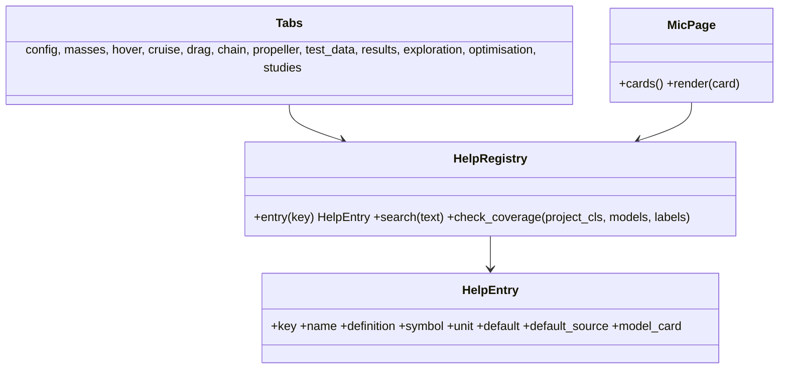

# GUI of the designer's workflow

## Requirements

- One Streamlit GUI following the designer's workflow, tab by tab, with the data behind
  every number visible and a help on every quantity.
- Pages (sidebar navigation): **Pre-sizing** (the tabs below) and **Model cards (MIC)**.
- Boundary: no new physics in the pages; everything comes from the API.

## Entities

## Approach

1. **Sidebar:** project (open, save, save as), settings (PredimRC folder, profile by
   name, user data folder, studies root folder — default current working directory),
   Run, page selection (Pre-sizing, Model cards), glossary search.
2. **Aircraft configuration** (tab title = configuration name, editable): template
   (quadplane 4+1, tricopter, multicopter, tilt-rotor) applied immediately; motor table
   (unit type, role, x, y) with a "tilts" checkbox per motor; layout generator; CG
   (x, y); motor pre-selection from the target mass range (MIC-CFG-SIZ); top and front
   views.
3. **Masses and battery:** battery, mass items, maximum take-off mass, mass breakdown.
4. **Hover:** per-motor thrust table and front / rear ratio; per motor: surrogate power
   with 95 % band on the thrust–power plot, the test points of the pair, the physics
   curve, the operating point, power and thrust margins, trust flag (REQ-PROP-012);
   hover battery power.
5. **Cruise (PredimRC layout)** — arrangement of the PredimRC page `3-Geometrie`
   (screenshot of 2026-10-14), PredimRC labels verbatim, inputs in blue as in PredimRC:
   - left column, top to bottom: **Aile** table (rows Corde emplant., Corde saumon,
     Longueur, Flèche /BA, Vrillage, Dièdre; columns Trapèze 1–5) with its results block
     on the right (Surface totale, Corde moyenne, Envergure aéro, Envergure totale,
     Allongement, Allongement ellip., Foyer aile); **Stabilisateur** table and results
     (Levier stab, Hauteur stab, Ouverture, Ecart latéral, Profil, Foyer stab, Bras de
     levier, Volume de stab); **Fuselage** (Longueur, Levier nez, Largeur, Hauteur,
     Forme, Poutre, Position aile, Incidence liée; S.ac forced to 0 with the note of
     REQ-AERO-006; Surface mouillée, Surface projetée, Foyer fuselage); **Réglages**
     (Marge statique, CG, Foyer, Masses, Charge, Cz réglage, Profils étudiés, calages);
     **Géométrie (vue de dessus)**: the tool's plan view (with the motors) and,
     optionally, the PredimRC image;
   - right column: **Performances en palier (plané)**: Altitude, Temp., Densité air;
     sink rate, L/D and C_z versus V_x (km/h) as in PredimRC; then the tool's
     **aerodynamic power versus speed** (PredimRC, + drag sources, total) with V₁ and V₂
     marked; **Performances à vitesse imposée**: Vx 1, Vx 2 (km/h, = V₁, V₂, editable,
     default min power / max L/D), Re moy. 1 / 2, aerodynamic power and L/D versus C_z
     with the trimmed C_z marked;
   - iso-model check badge (curve and imposed speeds) and density shown next to the
     curves; the VLM / Cz distribution plots of PredimRC are not reproduced (Could).
   Multicopter: the tab explains that PredimRC is not used and shows the body drag.
6. **Drag:** source table with kind, shape, frontal area (from geometry or user), C_d,
   CdS, model formula and coefficient source, share at V₁; note "PredimRC accessory drag
   set to 0".
7. **Power chain:** battery length; lift ESC type (4-in-1 or separate) and positions
   (% of fuselage length, or % of arm length for separate lift ESCs of a multicopter /
   tricopter; % of fuselage length for every ESC of a quadplane 4+1); cruise ESC
   position (% of fuselage length); cable sections; derived lengths shown on the plan
   view and editable; waterfall of the losses battery → motors at hover, V₁, V₂;
   segments included in the test data greyed.
8. **Propeller sizing:** per cruise / tilt unit, efficiency versus pitch at V₁ and V₂
   (BEM + motor), best pitch per speed and compromise, hover penalty for tilt units,
   database propellers of the same diameter, button "use this pitch".
9. **Test data:** flight points table (hover, cruise), model versus measurement
   (deviation, inside the 95 % band?), calibration switch and report (MIC-CAL-REF);
   thrust–power data browser and CSV import (INC2-002); surrogate validation report.
10. **Results:** per target speed KPI tiles (hover power, cruise power, flight time ± σ,
    range), margins (negative in red), front / rear ratio, hand-check formula with the
    numbers, links to the data of each power.
11. **Exploration, Optimisation, Studies:** definitions, progress, tables and charts,
    store, compare, apply (INC2-008).
12. **Model cards page:** list of `mvp/docs/models/*.md` (id, title, status), rendered
    card, Mermaid diagrams rendered (`st.markdown` + mermaid component) or shown as code.
13. **Help on every quantity (REQ-UI-010):** `HelpRegistry` built from (a) project
    schema `description` + new `json_schema_extra` keys `symbol`, `definition`,
    `default_source`, `model`; (b) `Port` / `Param` declarations of every model; (c)
    `ui/glossary.yaml` for derived and displayed quantities (KPIs, chart axes, table
    columns). Widgets get `help=` from the registry (tooltip "?"); tables use
    `column_config(..., help=)`; charts carry axis labels from the registry and a
    "?" expander listing their quantities; a glossary page / search in the sidebar.

## Structure

### Dependencies
1. API: `evaluate` (two-phase), surrogate, chain, cruise curve, drag, studies, sizing,
   calibration, BEM pitch study.

### Layered Architecture
1. `ui/app.py` (navigation), `ui/pages/presizing.py`, `ui/pages/mic_cards.py`,
   `ui/tabs/*.py` (one module per tab, pure helpers + render), `ui/help.py`
   (`HelpRegistry`), `ui/glossary.yaml`.

## Operations

### Create - `src/predimrc_wrapper/ui/help.py` + `ui/glossary.yaml`
1. `HelpRegistry.from_sources(Project, REGISTRY, glossary)`; `entry(key)`;
   `tooltip(key) -> str` (definition, symbol, unit, default and source, model card);
   `check_coverage()` returning the keys without entry.

### Restructure - `src/predimrc_wrapper/ui/`
1. One module per tab under `ui/tabs/`; the current tabs Sizing, Propulsion and motors,
   Calibration, Propulsion charts merge into Aircraft configuration, Hover, Propeller
   sizing and Test data; Geometry views move into Aircraft configuration and Cruise.
2. `ui/pages/mic_cards.py`; cards packaged with the wheel (package data) or read from
   the repository when installed in development mode.

### Create tests - `tests/ui/`
1. Help coverage: every project field, model port / parameter, KPI label, chart axis and
   table column of the tabs has an entry with definition and unit (fails listing the
   missing keys).
2. App tests: tab list per configuration; configuration switch; tilt checkbox sets the
   role; Results show V₁ and V₂ tiles; MIC page lists every card; tooltips present on the
   inputs of each tab.
3. Propeller sizing helper: best pitch increases with the target speed.

## Norms

1. English labels; every label is a registry key (no free text for a quantity).
2. Long computations in spinners with progress; errors in `st.error` with details.

## Safeguards

1. Editing never runs PredimRC; only Run, exploration and optimisation do.
2. The GUI works without Excel for everything except the wing-borne cruise curve, with a
   clear message.
3. A missing help entry fails the test suite, not the GUI (fallback: the field
   description).

## Implementation notes (2026-10-15)

- Implemented: `ui/app.py` rewritten — sidebar pages Pre-sizing / Model cards (MIC) /
  Glossary (radio), settings (PredimRC folder, studies root); tabs: configuration (title
  = its name; unit types, motor table with a **tilts** checkbox, layout generator, CG,
  motor pre-selection, reference motors, top and front views), Masses and battery (with
  breakdown), Mission (hover time, V1 / V2, environment, scenario mode in an expander),
  Hover (per-motor table, front / rear ratio, power versus thrust per pair with test
  points, surrogate band and physics curve, closest test points, error guarantee, test
  tables), Cruise (PredimRC inputs, iso check, PredimRC result block, aero power versus
  speed with V1 / V2, imposed-speed and palier curves), Drag (sources with shapes, model
  report, drag power at V1), Power chain (wiring inputs, lengths from the geometry,
  losses per segment), Propeller sizing (efficiency versus pitch at V1 / V2, compromise,
  hover penalty of a tilting unit, "use this pitch"), Test data (flight points, comparison
  with the model, calibration of the scenario mode), Results, Exploration, Optimisation,
  Studies (list, compare two, apply a point, rename, delete).
- Help on every quantity: `ui/help.py` (`HelpRegistry` from the schema, the model ports /
  parameters and `ui/glossary.yaml`), tooltips on every form field, table column, KPI tile;
  coverage test `tests/ui/test_help_and_tabs.py` (154 displayed labels, 146 project fields,
  173 model quantities).
- Views without Streamlit: `hover_view`, `cruise_view`, `prop_sizing`, `test_data_view`,
  `studies_view`, `mic_page`, `two_phase_view`.
- Deviations: an extra Mission tab; the wing / stab / fuselage form labels are the field
  descriptions (English), the PredimRC labels are kept in the result table and curves;
  PredimRC image export not done (Could); the calibration still applies to the scenario
  mode only.

## GUI feedback of 2026-10-15 (implemented)

- Motor pre-selection: the full formula (P_h, shares s_i, P_i, cruise power) and its use
  are written in the expander.
- Layout generator: only the layouts of the current configuration (tricopter → tricopter
  layout; multicopter → N arms ≥ 4; winged → quadplane 4+1 or tricopter with wing).
- Template names: `quadplane_4p1` (was `tricoptere_short_2_quadplane`, the name of the
  PredimRC example case its wing comes from), `tricopter_wing_tilt`; configuration labels
  say whether there is a wing.
- Tilts column only for winged configurations; a multicopter flies forward by tilting
  the frame.
- Multicopter cruise drag: body shape (PredimRC C_d) × frontal area (REQ-CFG-012).
- Drag: no source taken from PredimRC; rows deletable (row selector + bin icon).
- Power chain: definitions of main / DC / phase cables, distribution point, battery
  position and automatic gauges; diagram of the cables and ESCs; table of lengths and
  gauges; wiring inputs always shown with their defaults; cruise ESC hidden for a
  multicopter.
- Propeller sizing: sizing points stated (cruise V1, V2 with the thrust per motor);
  efficiency versus pitch chart with the best pitch per speed, the compromise and the
  current pitch.
- PredimRC session: checked before use and reopened when Excel was closed
  (`PredimRCWrapper.is_alive`), fixing "L'objet n'est pas connecté au serveur".
