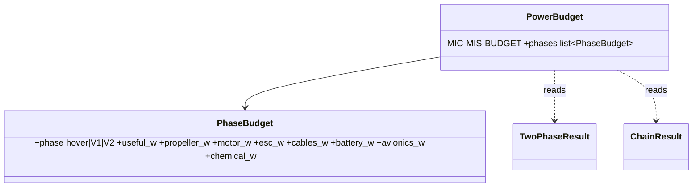

# GUI feedback of 2026-10-17 (fixes and clarity)

## Requirements

- No error after changing the ESC topology or the motor list once a result exists.
- Propeller sizing distinguishes the cruise motors from the lift-only motors.
- Thrust in N (kg), speeds in km/h, pitch in inches.
- The Test data tab explains the comparison with a sketch and formulas.
- The Results tab lists every power sink; they add up to the chemical power.
- Drag tab before Hover; Exploration / Optimisation / Studies on a sidebar page.
- PredimRC folder visible and editable in the first tab.

## Entities

## Approach

1. **4-in-1 bug** (`ui/app.py`, Power chain tab: `currents[m.index]` out of range):
   use the hover currents only when the result is up to date and its motor indexes fit
   the current project; otherwise the default currents.
2. **Pitch sections:** a "Cruise motors" section (units having a cruise or tilting motor)
   with the efficiency versus pitch chart at V₁ / V₂; lift-only units in a collapsed
   "Lift motors (sized in hover)" section.
3. **Units:** `ui/units.py` with `thrust_text(n) -> "12.3 N (1.25 kg)"` and `kmh(v)`;
   used by the KPI tiles, the tables (`two_phase_view`, `hover_view`, `prop_sizing`,
   `cruise_view`, `studies_view`) and the chart axes; Mission inputs V₁ / V₂ in km/h,
   stored in m/s. Glossary entries renamed.
4. **Test data explanation** (`ui/explanations.py`): `st.latex` formulas and a plotly
   sketch of the energy chain, per phase: hover, winged cruise (PredimRC imposed speed +
   drag sources), multicopter cruise (in-house body C_d·A + drag sources + Glauert forward
   flight; PredimRC not used). Calibration section: scenario mode only, why one factor per
   point.
5. **Power budget** (`mission/power_budget.py`): per phase, useful power (hover
   Σ T^1.5/√(2ρA); cruise D·V), propeller = shaft − useful, motor = I²R_m + I₀·U_emf
   (MotorModel), ESC, cables (main, DC, phase from ChainResult), battery internal,
   avionics. Closure: Σ sinks = chemical power (the remainder, if any, is reported as
   "unassigned" and must be 0 to 1e-9). Results tab: stacked bar + table.
6. **Navigation:** tab order Configuration, Masses and battery, Mission, Cruise, Drag,
   Hover, Power chain, Propeller sizing, Test data, Results; sidebar radio Pre-sizing /
   Studies / MIC cards / Glossary; the Studies page reuses the existing tab code.
7. **PredimRC folder** in the first tab, next to the profile selector, writing
   `settings.Settings`, with the naming rule shown.

## Structure

### Dependencies
1. `mission/power_budget.py` depends on `mission/two_phase.py`, `propulsion/chain.py`,
   `propulsion/motor.py`; the GUI depends on it, not the reverse.

## Operations

### Create - `src/predimrc_wrapper/ui/units.py`
### Create - `src/predimrc_wrapper/ui/explanations.py`
### Create - `src/predimrc_wrapper/mission/power_budget.py` (MIC card `MIC-MIS-BUDGET`)
### Update - `src/predimrc_wrapper/ui/app.py`, `prop_sizing.py`, views, `glossary.yaml`
### Create tests
1. App test: Run, switch to a 4-in-1 ESC, the Power chain tab renders.
2. Units helpers.
3. Power budget closes for the tricopter and the quadplane.
4. Help coverage still complete; tab list and sidebar pages.

## Norms

1. Displayed units only change at the GUI boundary; SI inside.
2. Every new quantity has a help entry (REQ-UI-010).

## Safeguards

1. An outdated result is never combined with a changed project.
2. The power budget test fails if a sink is missing (closure).
