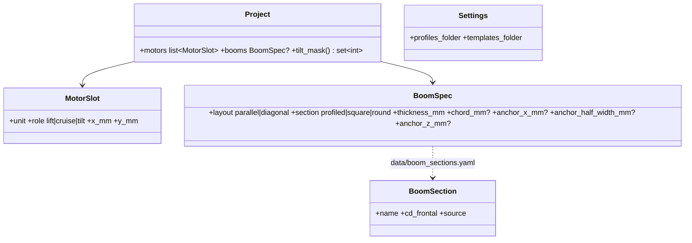

# Configurations

## Requirements

- Any tilt mask (e.g. tricopter with wing, only the rear motor tilting); table and drawing
  always agree; neutral template names.
- Save the current configuration as a user template; no template per mask.
- Propulsion unit types explained where they are added.
- Wing / stabiliser / fuselage geometry in the first tab.
- Motor positions drawn with their reference point and dimensions; clear overlap message.
- Diagonal booms from an anchor under the fuselage, section profiled / square / round,
  drag from the frontal area shown in the Drag tab, cables along the booms.

## Entities

## Approach

1. **Tilt mask:** the "tilts" checkbox column (stale state) is replaced by a multiselect
   "Tilting motors" (motor numbers) with quick choices front / rear / all / none; applying
   it sets the roles (tilt for masked lift motors, back to lift otherwise) and rebuilds the
   motor editor (`layout_version` bump). Template "Tricopter with wing" (any mask).
   Validation: a winged aircraft keeps ≥ 1 cruise or tilting motor.
2. **User templates:** a template is a complete project file. "Save as template" in the
   sidebar writes it to `Settings.templates_folder`; `Project.template` and the
   Configuration selector look up shipped then user templates; rename / delete in the
   sidebar.
3. **Unit types:** "Add a propulsion unit type" with its explanation (REQ-UI-010).
4. **Geometry in the first tab:** the AeroSpec form moves from Cruise to the
   configuration tab; Cruise keeps the PredimRC results and curves.
5. **Positions drawing** (`ui/positions_view.py`) from the raw table: origin named (wing
   root LE / frame centre), x and y dimension lines and values per motor, discs, overlaps
   in red.
6. **Overlap message** (`Project._check_overlap`): motor numbers, diameters, centre
   distance, minimum distance, suggestion.
7. **Booms:** `BoomSpec` (defaults: anchor under the fuselage at the wing spar station,
   half width = fuselage half width). Diagonal: boom i from the anchor (side of the motor)
   to motor i; L_i = |motor − anchor| (3D, anchor depth z); θ_i = angle between the boom and
   the flow (x axis). Frontal area A_i = t·L_i·sin θ_i; drag by the cross-flow principle
   (Hoerner, *Fluid-Dynamic Drag*): D_i = ½ρV²·C_d,section·sin²θ_i·A_i. Section
   coefficients referred to the frontal area in `data/boom_sections.yaml` with source:
   round ≈ 1.2 (circular cylinder, subcritical Re), square ≈ 2.0 (flat face to the flow),
   profiled ≈ 0.1 (streamlined, t/c ≈ 0.25). Parallel booms keep the increment 2 model
   (skin friction + base drag, base area from the section).
8. **Drag tab:** booms listed as an automatic source (not editable there): section, θ, L,
   A, C_d·sin²θ, CdS, drag power at V₁.
9. **Cables along the booms:** `propulsion/wiring.default_layout` and
   `ui/wiring_view.diagram` route the DC and phase cables anchor → motor for diagonal
   booms; parallel layout unchanged.

## Structure

### Dependencies
1. `aircraft/drag_sources.v_arm_segments` generalised to the boom section and reused for
   the boom geometry.
2. `data/boom_sections.py` loads the YAML with provenance like the other data files.

## Operations

### Update - `src/predimrc_wrapper/aircraft/project.py` (BoomSpec, tilt mask, overlap message, user templates)
### Create - `src/predimrc_wrapper/data/boom_sections.yaml`, `data/boom_sections.py`
### Create - `src/predimrc_wrapper/ui/positions_view.py`
### Update - `aircraft/drag_sources.py`, `propulsion/wiring.py`, `ui/wiring_view.py`, `ui/geometry.py`, `ui/app.py`, `settings.py`
### Update card - `MIC-CFG-DRAG` (boom model)
### Create tests
1. Tilt mask → roles; the tricopter with wing and mask {3} evaluates.
2. User template saved, listed, reloaded identically.
3. Diagonal booms: lengths, θ, frontal areas, drag per section by hand; cable lengths.
4. Overlap message content; positions figure has one dimension pair per motor.

## Norms

1. Booms are edited only in the configuration tab; the Drag tab displays them.
2. Every boom coefficient carries its source.

## Safeguards

1. Old project files without `booms` load unchanged (parallel layout, previous model).
2. A tilt mask naming a motor that does not exist is rejected with the valid numbers.
