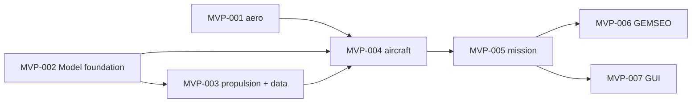

# predimrc_wrapper — MVP

> **Next: increment 2** (`inc2/README.md`, 2026-10-14) reproduces the designer's
> two-phase flight-time process. The code added after the MVP on 2026-10-12/13 (motor
> list and roles, tricopter and tilt-rotor templates, sizing law, calibration, pitch
> study, optimisation tab, 150–250 W motor database) is recorded by canvas INC2-001;
> the MVP canvases below are not rewritten.

This folder holds the specification of the **minimum viable product** only. The full,
longer-term specification stays in `docs/requirements/` and `spdd/` and is not
changed by this folder. Requirement identifiers are the same as in the full
specification, so that MVP items stay traceable when the full scope is implemented.

## Definition of done

1. `python examples/mvp/optim_quadplane.py` optimises a quadplane built from the
   PredimRC reference case `tricoptere_short_2` (SD7003), with PredimRC in the loop.
2. `python examples/mvp/optim_multicopter.py` optimises a quadcopter, without Excel.
3. Both scripts maximise the flight time of a "hover time + cruise until reserve"
   scenario. Variables: battery mass, cell count, lift motor (categorical), propeller
   diameter, and (quadplane) the length of wing panel 2. Constraints: motor current,
   battery discharge rate, lift thrust-to-weight and maximum take-off mass margins.
   Each script prints the optimum, its optimal speeds and its margins.
4. The Streamlit GUI opens both template projects, evaluates them, shows the results
   and saves a YAML file that the API reads back identically.
5. The 9 MIC cards in `docs/models/` describe every model used, with the description
   of all their parameters.

## Layout

| Path | Content |
|---|---|
| `specs/requirements/` | MVP requirements, one file per area, vimseo format |
| `specs/canvases/` | REASONS canvases, one per work package, to run with `/spdd-generate` |
| `docs/models/` | MIC cards of the 9 MVP models (Markdown) |

## Work packages (in order)

| Canvas | Package | Exit criterion |
|---|---|---|
| MVP-001 | PredimRC wrapper hardening | reference case within 0.5 %, template untouched, evaluation cost measured |
| MVP-002 | `Model` foundation | Port / Param / CompositeModel, generic tests, MIC Interface generation |
| MVP-003 | Propulsion models and motor data | model-form tests pass, 6 motors loaded with provenance |
| MVP-004 | Aircraft: configuration, mass, drag, project file | example projects round-trip; exact mass budget |
| MVP-005 | Mission | `evaluate(project)` gives flight time, range, V_e, V_r, margins; energy conserved |
| MVP-006 | GEMSEO discipline and examples | both optimisation scripts run end to end |
| MVP-007 | Streamlit GUI | both templates open, evaluate, display, save / reload |

## Decisions taken (2026-10-12)

- Architectures: **quadplane and multicopter**. Tilt-rotor after the MVP.
- Evaluation of FAST-UAV and uav-early-design (full-spec SPEC-009): after the MVP.
- MIC cards: Markdown in `docs/models/`; the Interface section is generated from the
  `Model` declarations once MVP-002 exists.
- Simplified-model defaults: FM 0.65, cruise propeller η 0.70, η_esc 0.95, transition
  at hover power × 1.0 for 15 s, 20 % energy reserve, minimum lift T/W 1.5.
- `cz_reg` imposed (not derived) in the MVP.
- PredimRC "Flèche /BA" values are absolute leading-edge offsets in mm (`le_offset_mm`),
  to be confirmed in the workbook during MVP-001.
- Language: English.

## Out of the MVP

Credibility (calibration, validation; only model-form tests remain, as unit tests),
tilt-rotor, CT/CP propeller tables and automatic propeller selection, η_esc(d),
wiring, equipment, cost, battery sizing, multi-scenario evaluation, Excel pool,
derived `cz_reg` and trim, imposed speed per segment, PredimRC appendage routing,
JSON Schema export. The 100 configurations / 20 s budget is measured, not required.

## Open point affecting the MVP

- Saving from the GUI a YAML written by hand loses its comments (full-spec open point
  10). MVP behaviour: the GUI writes a new file and defaults to "Save as" when the
  project was opened from disk.
