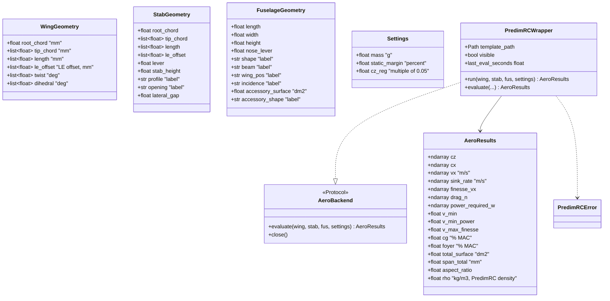

# Harden the PredimRC wrapper as the MVP aero backend

## Requirements

- Make `PredimRCWrapper` a reliable, repeatable aero backend for the quadplane: never
  modify the template, apply every setting, accept drop-down labels, keep one Excel
  session, and expose drag and required power versus speed.
- Measure the cost of one evaluation, to size the exploration budget.
- Boundary: SD7003 workbook only, `cz_reg` imposed, no image capture, no propeller tab,
  no appendage routing, no Excel pool.

## Entities

## Approach

1. Workbook session (findings of 2026-10-12, confirmed with Excel 16):
   - Open the template **in place, read-only** (`read_only=True`) and close it
     **without saving**: the template can never be modified (REQ-AERO-002).
   - Macros are required: the polar uses VBA functions (`Cxp2`, `CxpFuse`, `CxpStab`).
     Set `AutomationSecurity = 1` (macros enabled) before opening.
   - Set `EnableEvents = False` before opening: `Workbook_Open` runs `InitAppli`, which
     ends with a modal form (`UserForm01.Show`) that blocks automation. Keep events off
     for the whole session (no `Worksheet_Change` nor close macros).
   - Activate the workbook after opening; `display_alerts = False`.
   - The sheet `3-Geometrie` is protected; all input cells listed below are unlocked.
   - The template `profiles/PredimRC_SD7003.xls` was replaced on 2026-10-12 by the
     corrected file from the user; the previous one (`*.old.bak.xls`) returned #N/A on
     the whole polar in automation.
2. Input cell map (sheet `3-Geometrie`):
   - Wing: root chord `C6` (D6:F6 are formulas); tip chords `C7:G7`; lengths `C8:G8`;
     LE offsets `C9:G9`; twist `C10:G10`; dihedral `C11:G11`.
   - Stabiliser: root chord `C15`; tip `C16:G16`; length `C17:G17`; LE offset
     `C18:G18`; lever `C19`; height `E19`; airfoil `G19` (index); opening `C20`
     (index); lateral gap `E20`.
   - Fuselage: length `C24`; width `E24`; nose lever `C25`; height `E25`; shape `G24`
     (index); beam `G25` (index); wing position `C26` (index); linked incidence `E26`
     (index); accessory area `F26` (dm²); accessory shape `G26` (index).
   - Settings: mass `C33` (g); static margin spinner `N31` (in %, `D29 = N31/100`);
     trim Cz spinner `N32` (`F30 = N32/20`, so `cz_reg` is written as `cz_reg·20` and
     must be a multiple of 0.05).
   - There is no reference-speed input in PredimRC: `vx1` is removed; interpolation at
     a speed is done in Python by the mission (MVP-005).
3. Drop-downs are form controls whose linked cell holds a **1-based index**. Labels are
   read once from their list ranges on `Calculs1`: stabiliser airfoil `L180:L185`,
   opening `E146:E161`, fuselage shape `D162:D164`, beam `E162:E165`, wing position
   `A168:A171`, incidence `AC1:AC2`, accessory shape `D169:D171`. The wrapper accepts
   labels and writes `index = labels.index(label) + 1`; an unknown label raises
   `PredimRCError` with the list.
4. Outputs (sheet `Calculs1`, mass 1 / airfoil 1 block, rows 5–30): `B` Cz, `AE` Cx
   total, `AH` Vx **in km/h**, `AK` Vz (m/s, negative), `AN` L/D, `AQ` power (W).
   Rows with #N/A (stall side, very low Cz) are dropped. Sheet `3-Geometrie`:
   `L5:L10` wing metrics, `C30` CG and `C31` neutral point (fractions of MAC),
   `C34` wing loading (g/dm²). `Calculs1!B1` is the air density used by PredimRC
   (1.164 kg/m³ in the template), returned as `rho` so that the polar can be moved to
   another density at equal dynamic pressure (MVP-004).
5. Derived outputs, SI: `vx = AH/3.6`; `drag_n = m·g·|Vz| / vx`;
   `power_required_w = drag_n·vx` (equals `AQ`); `v_min` = lowest valid speed;
   `v_min_power` = argmin of power; `v_max_finesse` = argmax of L/D.
6. I/O cost: calculation mode set to **manual** for the whole session (otherwise each
   cell write recalculates the workbook, VBA functions included: 3.8 s per evaluation
   measured on 2026-10-12), one explicit `calculate()` per evaluation; one range write
   per panel row and one range read per output column; time each `run()` in
   `last_eval_seconds`.
7. Errors: COM errors wrapped in `PredimRCError`; `logging` instead of `print`.

## Structure

### Inheritance Relationships
1. `AeroBackend` is a `typing.Protocol`.
2. `PredimRCWrapper` implements it and is a context manager.
3. `PredimRCError` extends `RuntimeError`.

### Dependencies
1. `PredimRCWrapper` depends on `xlwings` (Windows, Excel 16), `numpy`.
2. `AeroModel` (MVP-004) depends only on `AeroBackend` and `AeroResults`.

### Layered Architecture
1. Input dataclasses (PredimRC units) → adapter (cell map, session) → `AeroResults`
   (new fields in SI).

## Operations

### Update module - `src/predimrc_wrapper/predimrc_wrapper.py`
1. Add `PredimRCError`, `AeroBackend`.
2. `PROFILE_FILES = {"SD7003": "PredimRC_SD7003.xls"}`.
3. `__enter__`: `xw.App(visible, add_book=False)`, `display_alerts=False`,
   `AutomationSecurity=1`, `EnableEvents=False`, open read-only, activate, read the
   drop-down label lists. `__exit__`: close without saving, quit Excel in `finally`.
4. `_index_of(field, label) -> int`; drop-down writes use it.
5. `_write_trapeze`: one range write per row; remove the debug print.
6. `_write_settings`: `C33` mass, `N31` static margin %, `N32` = `cz_reg·20` (check
   multiple of 0.05).
7. `_read_outputs`: one range read per column, conversion and derived outputs.
8. `run()` measures `last_eval_seconds`; `evaluate = run`; `close()`.
9. Dataclasses: `sweep` → `le_offset`; `StabGeometry.opening: str`, `lever: float`;
   `Settings` without `vx1`.

### Update script - `sandbox/main.py`
1. Labels for drop-downs, `lever=360.0`, `static_margin=5.0`, `cz_reg=0.30`.

### Create example - `examples/mvp/benchmark_aero.py`
1. 20 evaluations with varying wing panel 2 length; print mean and max time.

### Create tests - `tests/aero/`
1. `conftest.py`: `slow` marker, `excel_available` fixture (skip otherwise).
2. `test_template_unchanged` (slow), `test_reference_case` (slow, 0.5 %),
   `test_settings_written` (slow), `test_invalid_label` (fast, label resolution),
   `test_derive_drag` (fast, pure helper), `test_mass_changes_polar` (slow).

## Norms

1. Dataclass style kept; English docstrings with units per field.
2. PredimRC units in inputs; SI for outputs.
3. `logging.getLogger(__name__)`.
4. Excel tests marked `slow`.

## Safeguards

1. The template is byte-identical after any run, including a failing one (read-only
   open, never saved).
2. Reference case within 0.5 %: surface 30.795 dm², total span 1825 mm, aspect ratio
   9.831, CG 30.1 % MAC.
3. No Excel process left after exit; never touch an Excel instance the wrapper did not
   start.
4. `cz_reg` not a multiple of 0.05 ⇒ `ValueError`.
5. The evaluation time is reported, not enforced. Measured 2026-10-12: 0.94 s mean,
   1.06 s max over 20 evaluations (`examples/mvp/benchmark_aero.py`).
