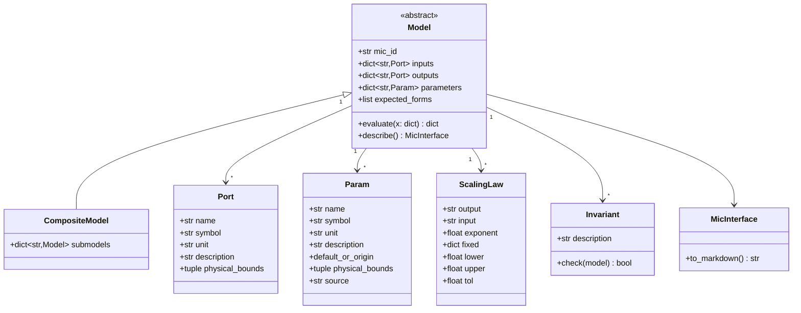

# Model foundation

## Requirements

- Give every MVP model one base class that declares its interface, parameters and
  expected relations, and evaluates purely in SI units.
- Generate the Interface section of the MIC cards from these declarations, so the code
  is the single source of truth.
- Provide one generic test suite for all models.
- Boundary: no GEMSEO discipline per model; no calibration metadata (bounds of
  calibration, priors) in the MVP.

## Entities

## Approach

1. `Model` is an abstract class with class-level declarations (`inputs`, `outputs`,
   `parameters`, `expected_forms`) and an instance holding parameter values (`self.p`,
   an immutable namespace built from defaults, database or project values).
2. `evaluate(x)` is pure: SI dict in, SI dict out, no state, no file I/O; numpy arrays
   accepted for vectorised sweeps.
3. Inputs and outputs are checked against `physical_bounds` in a `check=True` debug
   mode (off by default for speed).
4. `CompositeModel` holds named sub-models and an explicit `evaluate` wiring them.
5. `describe()` returns the Interface tables (inputs, outputs, parameters with name,
   symbol, unit, description, default or origin, physical bounds, source);
   `to_markdown()` renders them for the MIC card.
6. `Port`, `Param`, `ScalingLaw`, `Invariant` are frozen dataclasses.

## Structure

### Inheritance Relationships
1. All MVP models derive from `Model` or `CompositeModel` (MVP-003, MVP-004, MVP-005).

### Dependencies
1. `numpy` only.

### Layered Architecture
1. `src/predimrc_wrapper/core/model.py` (declarations, base classes),
   `core/mic.py` (Interface rendering), `core/units.py` (unit conversion helpers).

## Operations

### Create module - `src/predimrc_wrapper/core/model.py`
1. `Port`, `Param` dataclasses; helpers `ports(*p) -> dict`, `params(*p) -> dict`.
2. `Model.__init__(**param_values)`: fill from defaults; missing value without default
   → `ValueError` naming the parameter; values outside physical bounds → `ValueError`.
3. Abstract `evaluate(x)`; `check_io(x, y)` used when `check=True`.
4. `ScalingLaw`, `Invariant`; `CompositeModel(submodels)`.

### Create module - `src/predimrc_wrapper/core/mic.py`
1. `MicInterface` with `to_markdown()` producing the three tables.
2. `write_interface(model_cls, path)`: replaces the content between
   `<!-- interface:start -->` and `<!-- interface:end -->` in the MIC card.

### Create module - `src/predimrc_wrapper/core/units.py`
1. Conversions mm↔m, g↔kg, dm²↔m², mAh↔Ah, in↔m, km/h↔m/s.

### Create module - `src/predimrc_wrapper/core/sync_mic.py`
1. `python -m predimrc_wrapper.core.sync_mic` rewrites the Interface section of every
   MVP MIC card from the registered models.

### Create tests - `tests/core/` and `tests/model_forms/`
1. `test_model.py`: missing parameter, out-of-bound parameter, describe tables,
   `write_interface`.
2. `tests/model_forms/test_scaling_laws.py`: parametrised over all registered models
   and their `ScalingLaw` (log-log slope via `numpy.polyfit`) and `Invariant`; the same
   file checks that the Interface of each MIC card equals the generated one.
3. `ScalingLaw` and `Invariant` carry the parameter values used to build the model.

## Norms

1. SI everywhere inside models; unit suffix in names when ambiguous (`_m`, `_kg`, `_w`).
2. Docstrings in English, Google style, with the equations.
3. Models registered in a module-level registry used by the generic tests.

## Safeguards

1. `evaluate` never mutates its input nor the model.
2. A model without `mic_id` cannot be registered.
3. Generic tests cover every registered model automatically.
4. Interface sections of the MIC cards are never edited by hand once generated.
