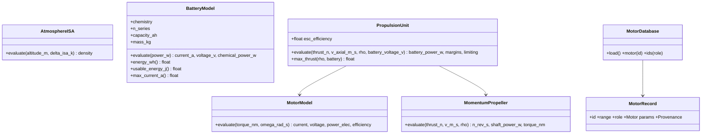

# Propulsion models and motor data

## Requirements

- Model the electric chain battery → ESC → motor → propeller at MVP fidelity, to get
  hover and cruise battery power and operating margins.
- Ship a small, sourced motor database.
- Boundary: momentum theory + FM for hover, constant efficiency for cruise propulsion,
  constant ESC efficiency; no propeller tables, no automatic selection, no wiring.

## Entities

## Approach

1. ISA troposphere density (MIC-ATM-ISA).
2. Battery: pack specific energy, nominal voltage, capacity-normalised internal
   resistance; current for a power from the quadratic R·I² − V₀·I + P = 0; chemical
   power V₀·I so Joule losses count in the energy (MIC-PROP-BAT). Defaults: LiPo 150
   Wh/kg, 4.2/3.7/3.3 V, 0.010 Ω·Ah, 30 C, 0.85; Li-ion 200 Wh/kg, 4.2/3.6/2.8 V,
   0.040 Ω·Ah, 8 C, 0.90.
3. Motor: Kv / R_m / I₀ model with current and power margins (MIC-PROP-MOT).
4. Propeller: hover P = T^1.5 / (FM·√(2ρA)), n from a static CT₀; cruise P = T·V / η_c
   (MIC-PROP-PRP, MVP variant). Defaults FM 0.65, CT₀ 0.10, η_c 0.70.
5. Unit: propeller → motor → battery power = P_el / η_esc (η_esc 0.95); feasibility on
   motor current, motor power and voltage (U_m ≤ 0.95·U_bat); `max_thrust` by bisection
   (MIC-PROP-UNIT, MVP variant).
6. Data: one YAML file with 6 T-Motor motors (MN4014 KV330 and KV400, MN3508 KV380,
   MN5008 KV340 for lift; AT2814 KV900, AT2312 KV1150 for cruise), values copied
   from manufacturer pages during generation, each with source URL, retrieval date and
   status. Values are never invented; an unreachable page is reported in
   `data/README.md`.

## Structure

### Inheritance Relationships
1. `AtmosphereISA`, `BatteryModel`, `MotorModel`, `MomentumPropeller` extend `Model`.
2. `PropulsionUnit` extends `CompositeModel`.

### Dependencies
1. `numpy`, `scipy` (`brentq`), `pyyaml`.

### Layered Architecture
1. `src/predimrc_wrapper/propulsion/` (models), `src/predimrc_wrapper/data/`
   (`motors_mvp.yaml`, `database.py`, `README.md`).

## Operations

### Create modules - `src/predimrc_wrapper/propulsion/`
1. `atmosphere.py`, `battery.py`, `motor.py`, `propeller.py`, `unit.py`, each declaring
   ports, parameters (with description, unit, default or origin, physical bounds,
   source) and `expected_forms` from the MIC cards.
2. `BatteryModel.from_capacity(chem, n_s, capacity_mah)` and `from_mass(chem, n_s,
   mass_kg)`.

### Create data - `src/predimrc_wrapper/data/`
1. `motors_mvp.yaml`: list of records `{id, manufacturer, range, role, kv, rm_mohm,
   i0_a, i_max_a, p_max_w, mass_g, source, retrieved, status}`.
2. `database.py`: `MotorDatabase.load()`, `motor(id)`, `ids(role=None)`; missing field
   or missing source → `DatabaseError(file, id, key)`.
3. Declare package data in `pyproject.toml`; add `scipy`, `pyyaml`, `pydantic>=2` to
   dependencies.

### Create tests - `tests/propulsion/`, `tests/data/`
1. Battery round trip; R = 0 ⇒ P_c = P; infeasible power above V₀²/4R.
2. Motor Q = 0 ⇒ I = I₀; efficiency < 1.
3. Propeller FM = 1 ⇒ ideal momentum power.
4. Unit P_b ≥ P_el ≥ P_shaft ≥ T·V; undersized motor ⇒ limiting = "motor_current".
5. Database loads; every entry has a source.

## Norms

1. SI inside models; manufacturer units only in the YAML with unit suffixes.
2. Each model's docstring repeats its MIC equations.

## Safeguards

1. Model-form tests pass: P ∝ T^1.5, ρ^−0.5, D^−1; E ∝ m_b; R_pack ∝ n_s/C.
2. An infeasible point is never reported as feasible with a finite power.
3. No motor value without a source.
