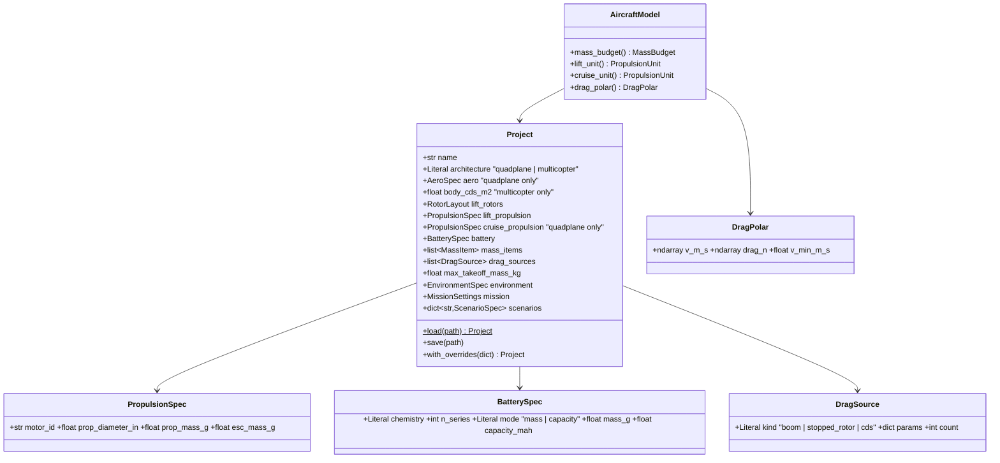

# Aircraft: configuration, mass, drag, project file

## Requirements

- Describe a quadplane or a multicopter design in one validated YAML project, shared by
  the API, the GUI and GEMSEO.
- Turn a project into the quantities the mission needs: total mass and breakdown,
  propulsion units, and drag versus speed (PredimRC + dedicated sources for the
  quadplane, body CdS for the multicopter).
- Boundary: no tilt-rotor, no coaxial, no PredimRC appendage routing, no equipment, no
  cost, no JSON Schema export.

## Entities

## Approach

1. Project: pydantic v2 models, `extra="forbid"`, `Literal` enumerations, bounded
   `Field`s with units in the field name (`_mm`, `_g`, `_mah`, `_in`). Each field
   carries `json_schema_extra={"level": "required" | "default" | "advanced"}` used by the
   GUI (REQ-UI-006). Architecture invariants enforced by model validators.
2. `with_overrides({"battery.mass_g": 700, "aero.wing.length_mm.1": 320})` applies
   dotted paths (list indexes as integers) on the dict dump and re-validates; unknown
   path → `OverrideError` with `difflib` suggestions.
3. Mass budget (MIC-CFG-MASS, MVP variant): user items + n·(motor + propeller + ESC)
   per propulsion group + battery; `margin_mass` when `max_takeoff_mass_kg` is set.
4. Drag (MIC-CFG-DRAG, MVP variant): booms CdS = C_f·π·d·L + C_d,end·π·d²/4; stopped
   rotor CdS = n_b·c̄·R·C_d,b; free CdS. Quadplane D(V) = PredimRC drag at total mass +
   ½ρV²ΣCdS. Multicopter D(V) = ½ρV²·body_cds.
5. `AeroModel` is a plain adapter (PredimRC is an external model without MIC card) that
   wraps the injected `AeroBackend`; PredimRC results are memoised on (geometry, mass
   rounded to 1 g). The PredimRC polar is computed at the workbook density ρ_p
   (`Calculs1!B1`) and moved to the flight density at equal dynamic pressure:
   D(V, ρ) = D_p(V·√(ρ/ρ_p)) (Reynolds neglected).
6. Template projects shipped in the package, `predimrc_wrapper/templates/quadplane.yaml`
   (tricoptere_short_2 + 4 lift rotors + cruise unit) and `multicopter.yaml`
   (quadcopter), loaded with `Project.template(architecture)`, each with a starter
   scenario `hover_90s`. The scenario format (`Segment`, `Scenario`) lives in
   `mission/scenario.py`, which has no dependency on the rest of the package.

## Structure

### Inheritance Relationships
1. `AeroModel`, drag and mass models extend `Model` / `CompositeModel` (MVP-002).
2. `OverrideError`, `ProjectError` extend `ValueError`.

### Dependencies
1. `pydantic>=2`, `pyyaml`; `AircraftModel` depends on MVP-001 (backend), MVP-003
   (units, database).
2. No `xlwings` import outside `predimrc_wrapper.py`.

### Layered Architecture
1. `aircraft/project.py` (schema, YAML I/O, overrides), `aircraft/mass.py`,
   `aircraft/drag.py`, `aircraft/aero.py`, `aircraft/model.py` (`AircraftModel`).

## Operations

### Create module - `src/predimrc_wrapper/aircraft/project.py`
1. Pydantic models of the diagram; validators: quadplane ⇒ `aero` and
   `cruise_propulsion` set; multicopter ⇒ `aero` absent and `body_cds_m2 > 0`;
   `motor_id` exists in the database.
2. `load(path)`, `save(path)` (`yaml.safe_dump(sort_keys=False)`), `format_version: 1`,
   tool version recorded.
3. `with_overrides(overrides: dict[str, Any]) -> Project`.
4. `defaults_left(project) -> list[str]`: fields equal to their default (REQ-UI-007).

### Create modules - `aircraft/mass.py`, `aircraft/drag.py`, `aircraft/aero.py`, `aircraft/model.py`
1. Mass and drag models per Approach 3–4, with MIC declarations.
2. `AeroModel.evaluate(mass_kg) -> DragPolar` (memoised backend call; quadplane only).
3. `AircraftModel(project, db=None, aero_backend=None)`; `drag_polar()` raises
   `ProjectError` if a quadplane has no backend.

### Create templates - `src/predimrc_wrapper/templates/quadplane.yaml`, `multicopter.yaml`

### Create tests - `tests/aircraft/`
1. Round trip of both templates; overrides; unknown path suggestions; invariants.
2. Mass sum exact; `margin_mass` sign.
3. Drag formulas; multicopter without `xlwings` in `sys.modules`.
4. Quadplane through PredimRC (slow).

## Norms

1. YAML keys snake_case with unit suffixes; SI inside models.
2. Backend injected, never created in physics code.

## Safeguards

1. `load(save(p)) == p` for both templates.
2. Total mass is the exact sum; no double counting.
3. A multicopter project never imports `xlwings`.
4. Re-evaluating the same geometry and mass costs no Excel call.
