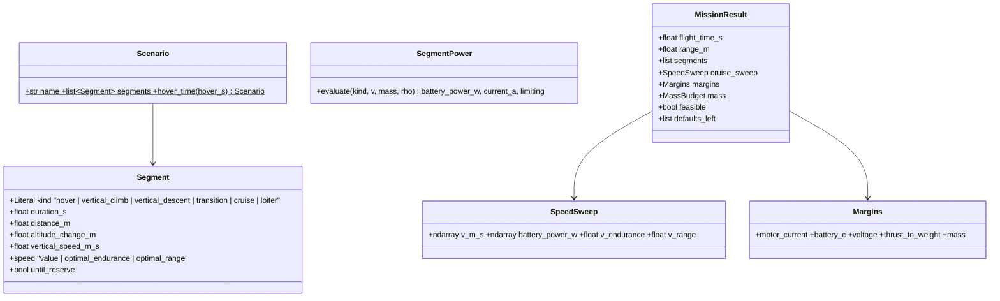

# Mission: scenario solver

## Requirements

- Compute, for a project and one scenario, flight time, range, energy per segment,
  best-endurance and best-range speeds and operating margins.
- Provide the single entry point `evaluate(project, scenario)` used by GEMSEO and the
  GUI.
- Boundary: quasi-steady segments, constant mass, no wind; vertical climb / descent at
  hover power; no battery sizing, no trim, no imposed-speed envelope margin.

## Entities

## Approach

1. Segment powers (MIC-MIS-SEG, MVP variant):
   - hover, vertical climb, vertical descent: T_r = k_dl·m·g/n (k_dl 1.05 quadplane,
     1.0 multicopter), P_b = n·UNIT(T_r, 0) + P_av;
   - transition: κ_tr·P_hover (1.0) for its duration (default 15 s);
   - quadplane cruise / loiter: T = D(V) on the cruise unit, lift rotors at 0 W;
   - multicopter cruise / loiter: tan α = D_b/(m·g), T = √((mg)² + D_b²), Glauert
     induced velocity by fixed point, P_r = T_r·(V·sin α + v_i)/FM, then motor and ESC.
2. Speed sweep: V from 1.2·v_min (quadplane polar) or 1 m/s (multicopter) to the
   highest feasible speed, step 0.25 m/s, vectorised; V_e = argmin P_b, V_r = argmin
   P_b/V, parabolic refinement.
3. Integration (MIC-MIS-SOL, MVP variant): E_k = P_c,k·t_k (chemical power from the
   battery model); available energy E_u·(1 − reserve); `until_reserve` duration keeps the
   energy of the following segments.
4. Margins: worst case over segments; T/W = n·T_max/(m·g) − T/W_min; `margin_mass`
   from MVP-004.
5. `Scenario.hover_time(hover_s)`: vertical climb 30 m at 2 m/s, hover, transition,
   cruise at best range until reserve, transition, vertical descent 30 m at 1.5 m/s
   (multicopter: no transition).
6. `evaluate(project, scenario_name=None, backend=None) -> MissionResult` (first scenario
   by default); opens a `PredimRCWrapper` only for a quadplane without injected backend,
   with the workbooks of `$PREDIMRC_PROFILES` (default `./profiles`).
7. Observed on the quadplane template (2026-10-12): the PredimRC polar stops near
   Cz ≈ 0.86, so the best-endurance and best-range speeds sit at the lower sweep bound
   1.2·V_min (optimum bounded by the stall margin, as anticipated).

## Structure

### Inheritance Relationships
1. `SegmentPower`, `MissionSolver` extend `CompositeModel`.

### Dependencies
1. MVP-003 (unit, battery, ISA), MVP-004 (aircraft model, drag polar, mass).

### Layered Architecture
1. `mission/scenario.py`, `mission/powers.py`, `mission/solver.py`,
   `src/predimrc_wrapper/api.py` (`evaluate`).

## Operations

### Create modules - `src/predimrc_wrapper/mission/`
1. `scenario.py` (written with MVP-004, no dependency on the rest of the package):
   `Segment`, `Scenario` (pydantic, same format as the project `scenarios` section);
   exactly one of duration / distance / altitude change / until_reserve per segment.
   `mission/__init__.py` imports the solver lazily to avoid a circular import.
2. `powers.py`: `SegmentPower` per Approach 1, with MIC declarations and
   `expected_forms` (multicopter at V = 0 ≡ hover).
3. `solver.py`: `MissionSolver.cruise_sweep()`, `solve(scenario) -> MissionResult`.

### Create module - `src/predimrc_wrapper/api.py`
1. `evaluate(...)` per Approach 6; result metadata: tool version, database version,
   project hash.

### Create tests - `tests/mission/`
1. Energy additivity; reserve left exactly; zero hover time ⇒ pure-cruise endurance.
2. Parabolic polar with constant efficiencies ⇒ V_r/V_e = 3^0.25 within the grid step.
3. Multicopter at V = 0 equals hover power.
4. Quadplane template through PredimRC (slow).

## Norms

1. SI internally; convenience properties `flight_time_min`, `range_km`.
2. Simplified models and their default factors documented in the MIC cards.

## Safeguards

1. Σ segment energies = energy used (1e-9 relative).
2. The reserve is never consumed.
3. An infeasible segment makes the mission infeasible and names the segment and limit.
4. Python physics ≤ 20 ms per scenario evaluation (measured in the benchmark).
