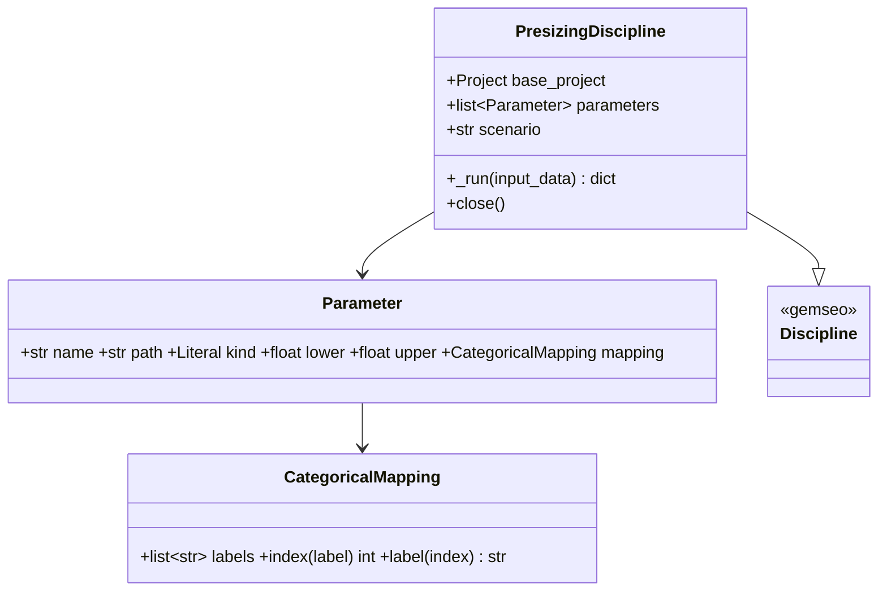

# GEMSEO discipline and examples

## Requirements

- Wrap `evaluate` in a GEMSEO discipline so that DOE and optimisation run on float,
  integer and categorical project parameters.
- Deliver the two MVP optimisation scripts and a timing DOE.
- Boundary: one scenario per discipline, sequential execution, single Excel session.

## Entities

## Approach

1. Inputs: one array of size 1 per `Parameter`; values mapped back with
   `Project.with_overrides`. Categorical parameters are integer indexes in [0, n−1].
2. Outputs: `flight_time`, `range`, `v_endurance`, `v_range`, `mass_total`,
   `margin_motor_current`, `margin_motor_power`, `margin_battery_c`, `margin_voltage`,
   `margin_thrust_to_weight`, `margin_mass` (if `max_takeoff_mass_kg` is set),
   `feasible`.
3. Execution: backend opened lazily once, closed by `close()`; GEMSEO cache; any
   `PredimRCError` / mission error ⇒ outputs NaN and `feasible = 0`, logged.
4. Examples: quadplane (battery mass, prop diameter, wing panel 2 length; lift motor via
   an outer loop over the categorical labels; n_series fixed to 4, the AT2308 cruise
   motor being rated 2-4S, which also keeps the Excel budget small); multicopter
   (battery mass, prop diameter; outer loop over lift motor and n_series ∈ {4, 6}); `doe_timing.py` (20-point LHS, prints mean evaluation time).
   Algorithms available with GEMSEO 6.3 without extra plugin (checked 2026-10-12):
   `SLSQP` with finite-difference gradients for optimisation (default, 60 iterations per
   discrete choice) and `LHS` for the DOE; OpenTURNS and NLopt plugins are not required.
   The objective is normalised (`flight_time_ratio = flight_time / flight_time(x0)`,
   GEMSEO `LinearCombination` chained after the discipline, MDF formulation) so that it
   is of the same order as the margins. `COBYQA` was tried first and rejected: on the
   quadplane it converged onto the bounds corner violating `margin_mass` (−0.03), with
   or without normalisation, and returned an early poor feasible point; SLSQP reaches
   the active mass constraint (checked on the analytic backend and with PredimRC).
5. `gemseo>=6` as optional extra `[mdo]` (6.3.3 installed); `_run(self, input_data)`
   returns the output mapping; GEMSEO default `SIMPLE` cache (last point). The
   `MEMORY_FULL` cache is not used: on Windows it starts a multiprocessing manager that
   re-imports `__main__`, which breaks unguarded scripts, notebooks and Streamlit; the
   costly PredimRC calls are already memoised by `AeroModel` (MVP-004).

## Structure

### Inheritance Relationships
1. `PresizingDiscipline` extends `gemseo.core.discipline.Discipline`.

### Dependencies
1. `api.evaluate` (MVP-005), `Project` (MVP-004), motor ids (MVP-003).

### Layered Architecture
1. `mdo/parameters.py` (Parameter, CategoricalMapping, `build_design_space`),
   `mdo/discipline.py`, `examples/mvp/*.py`.

## Operations

### Create module - `src/predimrc_wrapper/mdo/parameters.py`
1. `Parameter`, `CategoricalMapping`, `categorical(name, path, labels)`,
   `from_database(name, path, role)`, `build_design_space(parameters)`.

### Create module - `src/predimrc_wrapper/mdo/discipline.py`
1. `PresizingDiscipline(base_project, parameters, scenario=None, backend=None)`
   (scenario: first one of the project by default), grammars from names, default inputs
   from the base project, `initial_values()`, `project_for(input_data)`.
2. Examples share `examples/mvp/_optim.py` (outer loop over discrete choices, SLSQP with
   finite differences of step 1e-3 on the normalised design space, inequality
   constraints `margin_* ≥ 0`, best result and every choice saved as JSON with the
   labels). Design bounds stay strictly inside the project validators (prop diameter
   upper bound = layout maximum − 0.1 in): forward finite-difference steps taken at an
   upper bound go beyond it.

### Create examples - `examples/mvp/`
1. `optim_quadplane.py`, `optim_multicopter.py`, `doe_timing.py`; outputs (results and
   categorical mappings) written to `examples/mvp/outputs/` (git-ignored).

### Create tests - `tests/mdo/`
1. Mapping round trip; design-space types and bounds.
2. Multicopter discipline (no Excel): outputs equal `evaluate`; cache hit on a repeated
   input; no child process started; injected failure ⇒ NaN and `feasible = 0`.
3. `optim_multicopter.py` runs with a reduced budget (fast); `optim_quadplane.py` (slow).

## Norms

1. GEMSEO conventions: numpy arrays in and out; no side effect other than the backend.
2. Output names and units listed in the discipline docstring.

## Safeguards

1. Discipline outputs equal `evaluate` for the same project.
2. A failing point never stops a DOE.
3. Sequential execution only; one Excel instance.
4. The categorical mapping is saved with every study output.
