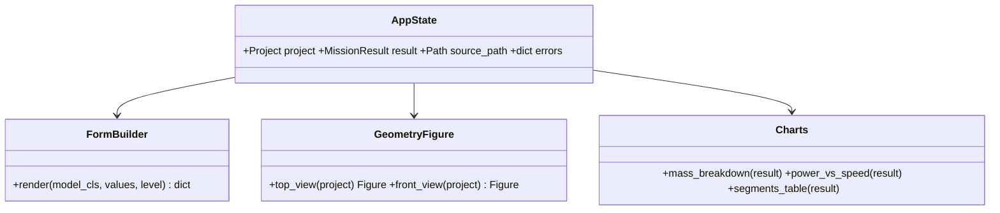

# Streamlit GUI

## Requirements

- Let the user open a template or a project file, edit every MVP input in forms
  generated from the project schema, preview the geometry, run one evaluation, read the
  results and save the project.
- Boundary: no optimisation from the GUI (scripts), no Credibility tab, no PredimRC
  capture, no automatic propeller choice.

## Entities

## Approach

1. Layout: sidebar (project open / template / save, architecture, scenario, Run) and
   tabs Aircraft (quadplane only), Rotors and masses, Propulsion, Drag, Scenario,
   Results.
2. Forms generated from the pydantic schema: widget chosen from the field type
   (`Literal` → selectbox, bounded number → number_input with min/max and unit,
   list → `st.data_editor`); level from `json_schema_extra`: required (*, Run disabled
   while missing), default (greyed value + "default" badge, "entered" once changed),
   advanced (inside an expander). Pydantic errors shown under the field.
3. Wing panels edited in one `data_editor` table (rows: chords, lengths, LE offsets,
   twist, dihedral; columns P1–P5).
4. Geometry: plotly top view (panels from absolute LE offsets, fuselage, stabiliser,
   booms, rotor discs) and front view (dihedral); multicopter draws body and rotors.
5. Run: `evaluate(project)` in a spinner; Excel session kept in `st.cache_resource`;
   the last result is kept in session state with the project hash and flagged
   "outdated" after an edit (no automatic re-run).
6. Results: KPI tiles (flight time, range, V_e, V_r, total mass, margins, negative in
   red), mass breakdown bar, segment table, P(V) curve with V_e and V_r marked, list of
   values left at default.
7. Save: `Project.save`; when the project came from disk, the dialog defaults to
   "Save as".
8. Launch: `predimrc-ui [project.yaml]` console script; optional extra `[ui]`
   (`streamlit`, `plotly`).

## Structure

### Inheritance Relationships
1. No inheritance; pages are functions.

### Dependencies
1. `Project` (MVP-004), `evaluate` (MVP-005), `MotorDatabase` (MVP-003).

### Layered Architecture
1. `ui/app.py`, `ui/forms.py`, `ui/geometry.py`, `ui/charts.py`, `ui/state.py`,
   `ui/cli.py`.

## Operations

### Create package - `src/predimrc_wrapper/ui/` (pure helpers first, Streamlit last)
1. `state.py` (no Streamlit import): `AppState(data, source_path, result, result_key,
   generation)`; `load_template(architecture)`, `load_file(path)`;
   `check(data) -> Check(project, errors, missing)` (pydantic errors by dotted path;
   `missing` = required fields absent or empty); `run_enabled(check)`;
   `save_project(data, path)` (via `Project.save`); `hover_scenario(architecture)`
   (starter scenario for "Add scenario"); `project_key(data)` (hash used to
   mark a result as outdated); `excel_available() -> str | None` (None when usable, else
   the reason shown to the user).
2. `forms.py`: pure part `field_level(info)`, `field_badge(info, value) -> "required" |
   "default" | "entered" | "advanced"`, `field_label(name, info, value)` (description +
   unit, `*` for required, badge for default level); Streamlit part
   `render_model(model_cls, values, path, errors, choices) -> dict`. Widget rules:
   `Literal` → selectbox; `bool` → checkbox; number → `number_input` (None allowed for
   optional numbers); `str` with `choices[path]` (motor ids from `MotorDatabase`) →
   selectbox, else text input; nested model → section; same-length `list[float]` fields
   of one model (wing / stab panels) → one `data_editor` table, rows = fields, columns
   P1…Pn, with a panel-count input; `list[model]` (mass items, drag sources, scenario
   segments) → one `data_editor` table, columns = fields, rows added / removed, empty
   cells → field absent; `dict[str, Scenario]` → scenario selector + segment table.
   Advanced fields inside an expander; errors under the field (`st.error`).
3. `geometry.py` (plotly only): `wing_outline(wing, root_offset_mm) -> Outline(x, y,
   half_span_mm)` with panels starting at the fuselage half-width, LE offsets absolute
   from the root LE; `top_view(project)`: stream-wise stations aft-positive from the
   wing LE, nose up; wing, stabiliser at `lever_mm`, fuselage box from `-nose_lever_mm`,
   booms, one circle trace named `rotor` per lift rotor (quadplane: rotors evenly from
   `x_front_mm` to `x_rear_mm` on each boom; multicopter: body and arms);
   `front_view(project)`: dihedral per panel, fuselage section, rotor discs as lines.
4. `charts.py`: `kpis(result) -> list[Kpi(label, value, unit, negative)]`,
   `mass_figure(result)`, `power_figure(result)` (battery power vs cruise speed,
   infeasible points greyed, V_e and V_r marked), `segment_rows(result)`.
5. `app.py`: Streamlit page per Approach 1–7; the result is kept in session state with
   its `project_key`, shown "outdated" after any edit, recomputed only on Run.
6. `cli.py`: `main(argv=None)` runs `streamlit run app.py [streamlit --options] --
   [project.yaml]` (`streamlit_argv` routes `--options` to Streamlit, the file to the app);
   `[project.scripts] predimrc-ui = "predimrc_wrapper.ui.cli:main"`.

### Create tests - `tests/ui/`
1. Reference wing half-span 912.5 mm (fuselage half-width 42.5 + Σ lengths 870); one
   `rotor` trace per rotor for both templates (4, then 6 rotors).
2. Form level logic: missing required field ⇒ Run disabled; changed default ⇒
   "entered"; untouched default ⇒ "default".
3. GUI save / API load round trip.
4. `streamlit.testing.v1.AppTest` smoke test on the multicopter template (no Excel):
   page renders without exception, Run gives the flight-time KPI.

## Norms

1. English labels with units; no physics or file-format logic in pages.
2. Long calls in spinners; errors with `st.error` and details in an expander.

## Safeguards

1. Editing a field never triggers PredimRC; only Run does.
2. The GUI works without Excel for the multicopter and for editing any project; running
   a quadplane without Excel shows a clear message.
3. A file saved by the GUI loads identically through the API.
