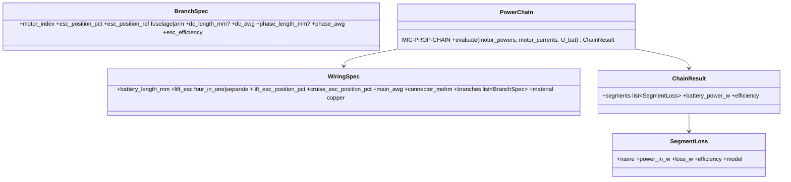

# Power chain

## Requirements

- Give, at hover and at each target speed, the power entering and the loss of each
  segment: battery internal resistance, main cables (battery to distribution), DC
  branch cables (distribution to each ESC), ESC, phase cables (ESC to motor), motor.
- Cable lengths, sections and material entered by the user; defaults estimated from the
  geometry of the configuration; sections defaulted from the current.
- Do not count twice what the thrust–power data already include (`measured_at`).

## Entities

## Approach

1. Cable resistance R = ρ(T)·L / A, copper ρ₂₀ = 1.72e-8 Ω·m, α = 0.00393 /K, wire
   temperature setting (default 40 °C); AWG table for A.
2. Main cables: 2 conductors, I_bat: P = I_bat²·2R_main + I_bat²·R_conn.
3. DC branch (ESC on the arm): 2 conductors per motor, I_dc,i. ESC: constant efficiency
   (default 0.95) or loss model P = P₀ + k·I² (Could). Phase cables: DC-equivalent
   P = I_m,i²·2R_phase (two phases conducting).
4. Motor losses from MIC-PROP-MOT (copper I²R_m and no-load I₀·U) for the information
   of the chain view.
5. Thrust–power data measured at `esc_input` (the table names the ESC) ⇒ the ESC loss
   is computed with the MVP model, P_loss = (1 − η_esc)·P_table (η_esc constant,
   default 0.95), and shown as part of the data (motor input power = η_esc·P_table);
   battery, main, DC branch and phase cable losses are added. `motor_input` ⇒ ESC loss
   (same model) and all cable losses added. The GUI shows which segments come from data.
6. Topology and positions (designer's rules, 2026-10-14):
   - the main cable starts downstream of the battery, at its rear end x_b = battery
     front position + `battery_length_mm` (battery front at the nose by default); the
     battery carries no cable length;
   - lift motors: one **4-in-1** ESC (position in % of the fuselage length from the nose)
     or **separate** ESCs; cruise motor: separate ESC (position in % of the fuselage
     length);
   - separate lift ESCs: position in % of the arm length from the arm root
     (multicopter, tricopter); quadplane 4+1: every ESC in % of the fuselage length;
   - the user enters the percentages; lengths derive from them and stay editable
     (override per branch).
7. Default lengths from the geometry: main cable x_b → distribution point (the 4-in-1
   ESC, else the position of the first ESC along the fuselage); DC branch distribution →
   ESC; phase cables ESC → motor. Paths: multicopter and tricopter arms straight from
   the frame centre; quadplane: along the fuselage, then lateral along the wing to the
   boom, then along the boom; V-arms: along the arm. Section default: smallest AWG
   whose ampacity (setting table) exceeds 1.25 × the hover current of the conductor.
8. Battery voltage under load solved with the chain (R_bat + R_main) by the existing
   quadratic battery model.
9. 4-in-1 ESC: one board, DC losses on the main cable only, ESC loss on the sum of the
   lift currents; phase cables from the board to each motor.

## Structure

### Inheritance Relationships
1. `PowerChain(Model)` with `mic_id = "MIC-PROP-CHAIN"`.

### Dependencies
1. `aircraft/project.py` gains `wiring: WiringSpec | None` (None ⇒ defaults from
   geometry, shown and editable); `aircraft/layouts.py` gives the cable paths.

### Layered Architecture
1. `propulsion/wiring.py` (resistance, AWG table, default lengths),
   `propulsion/chain.py` (PowerChain).

## Operations

### Create - `src/predimrc_wrapper/propulsion/wiring.py`
1. `AWG` table (mm², ampacity), `resistance(length_m, awg, temperature_c)`,
   `default_wiring(project) -> WiringSpec` with the paths of Approach 6.

### Create - `src/predimrc_wrapper/propulsion/chain.py`
1. `PowerChain.evaluate` vectorised over operating points; `ChainResult.segments` in
   battery → motor order.
2. Expected forms: losses sum exactly; zero length ⇒ zero cable loss; loss ∝ L at equal
   current.

### Create card - `docs/models/MIC-PROP-CHAIN.md`

### Create tests - `tests/propulsion/test_chain.py`
1. Hand calculation of the tricopter defaults (lengths, sections, losses at 280 W)
   with separate ESCs at 50 % of the arms, and with a 4-in-1 ESC at 40 % of the
   fuselage.
2. Quadplane 4+1: ESC positions in % of the fuselage length; main cable starts at the
   rear of the battery.
3. `esc_input` data ⇒ ESC loss = (1 − η_esc)·P_table shown inside the data, not added
   again, battery power unchanged by η_esc; `motor_input` ⇒ ESC loss and phase cables
   added.

## Norms

1. Every default is shown with its origin ("from geometry", "from current").
2. Lengths in mm, sections in AWG or mm² in the GUI; SI inside.

## Safeguards

1. A branch per motor is required once wiring is entered; a missing branch falls back
   to the default with a warning.
2. Battery power = Σ motor powers + Σ losses + avionics, checked by a test.

## Implementation notes (2026-10-14)

- Implemented: `propulsion/wiring.py` (copper resistance, AWG table, `default_layout`),
  `propulsion/chain.py` (`PowerChain` = MIC-PROP-CHAIN, `ChainResult`, `SegmentLoss`),
  `WiringSpec` / `BranchOverride` in the project; card `MIC-PROP-CHAIN.md`; tests
  `tests/propulsion/test_chain.py`.
- Phase cables carry the motor current I_m, the DC cables the supply current I = P / U
  (at part throttle the ESC lowers the voltage, I_m > I_supply).
- Rotary frames have no fuselage: battery centred on the frame, 4-in-1 board at the
  centre, separate ESCs at % of the arm.
- Not yet used by the flight time: connected in INC2-007.
