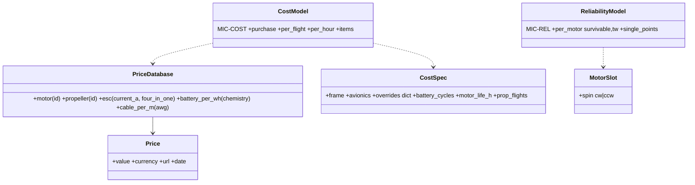

# Cost and reliability

## Requirements

- Purchase cost of motors, propellers, ESCs, battery, cables, frame, avionics, every
  price with its source.
- Cost of use per flight and per flight hour (battery, motor, propeller wear).
- Motor-out hover: survivable or not per motor, remaining T/W, single points of failure.
- Dedicated tab; outputs available to exploration and optimisation.

## Entities

## Approach

1. **Prices** `data/prices.yaml` (+ `data/prices.py`): motors of the database, propellers,
   ESCs by current rating, battery € per Wh per chemistry (retailer examples), cable € per
   m per AWG; URL, date, currency per entry. Project `CostSpec`: frame, avionics,
   overrides, wear settings.
2. **Purchase cost:** Σ items; cable lengths from the power chain; ESC chosen as the
   cheapest rating ≥ 1.25 × max current.
3. **Cost of use:** battery price / cycles per flight (LiPo 300, Li-ion 500), motors
   price × t_flight / life (1000 h), propellers price / flights between replacements;
   per flight (two-phase time at V₁) and per hour.
4. **Motor-out hover** (`reliability.py`): for each lift or tilting motor k removed, solve
   the least-squares thrust split of the remaining motors for vertical force, pitch, roll
   (from `hover_thrust_split`) and yaw Σ s_i·Q_i(T_i) = 0 (s_i = ±1 from `MotorSlot.spin`,
   Q from the surrogate / propeller model); survivable when 0 ≤ T_i ≤ T_max,i. A tricopter
   with a yaw-tilting rear motor skips the yaw equation. Defaults of `spin` alternate as in
   ArduPilot (`layouts`).
5. **GUI:** tab "Cost and reliability" (breakdown table with sources, pie chart, per-motor
   survivability); KPIs in Results; discipline outputs `cost_purchase`, `cost_per_hour`,
   `motor_out_tw` (`mdo/discipline.OUTPUTS_TWO_PHASE`).

## Structure

### Inheritance Relationships
1. `CostModel(Model)` with `mic_id = "MIC-COST"`; `ReliabilityModel(Model)` with
   `mic_id = "MIC-REL"`.

## Operations

### Create - `src/predimrc_wrapper/data/prices.yaml`, `data/prices.py`
### Create - `src/predimrc_wrapper/cost/model.py`, `src/predimrc_wrapper/reliability.py`
### Create cards - `docs/models/MIC-COST.md`, `MIC-REL.md` (interfaces by `sync_mic`)
### Update - `aircraft/project.py` (CostSpec, MotorSlot.spin), `mdo/discipline.py`, `ui/app.py`
### Create tests
1. Cost sums; override replaces a price; cost-of-use formula on a hand case.
2. Quadcopter X not survivable (yaw); hexacopter survivable; tricopter rule.

## Norms

1. A price without URL and date is rejected at load.
2. Currency shown with every amount (EUR by default; no conversion).

## Safeguards

1. Missing price ⇒ item flagged "no price" and excluded from the total, never zero.
2. The reliability check never changes the nominal evaluation.

## Implementation notes (2026-10-18)

- Prices: `data/prices.yaml` (USD, retrieved 2026-10-18) and `data/prices.py`; every entry
  has a URL and a status: `verified` (read on the product page) or `search` (read in a
  search result for that page, the page refused the robot: P13x4.4, T9545, 4-in-1 F55A).
  No 10 AWG wire price was found: the item stays "missing" until overridden.
- Propellers given only by diameter × pitch (the templates) are priced as the cheapest
  database propeller of the same diameter, status `estimate`.
- Cost: `cost/model.py` (`cost(aircraft, flight_time_s, hover_currents)`), card
  `docs/models/MIC-COST.md`; plain functions rather than a `Model` subclass (post-processing,
  no physics). Defaults: 300 / 500 cycles, motor life 1000 h, 200 flights per propeller.
- Reliability: `reliability.py` (`motor_out`), card `docs/models/MIC-REL.md`; linear
  programme with HiGHS (scipy). `MotorSlot.spin` (advanced, optional) overrides the
  alternating default.
- GUI: tab "Cost and reliability" (prices entered, overrides, purchase table with sources,
  cost of use after a Run, motor-out table, single points of failure); KPIs in Results.
  The `cost` section is stored in the project only once it differs from the defaults, so a
  Run stays up to date.
- MDO: outputs `cost_purchase`, `cost_per_hour`, `motor_out_tw` (two-phase mode) and the
  matching objectives.
