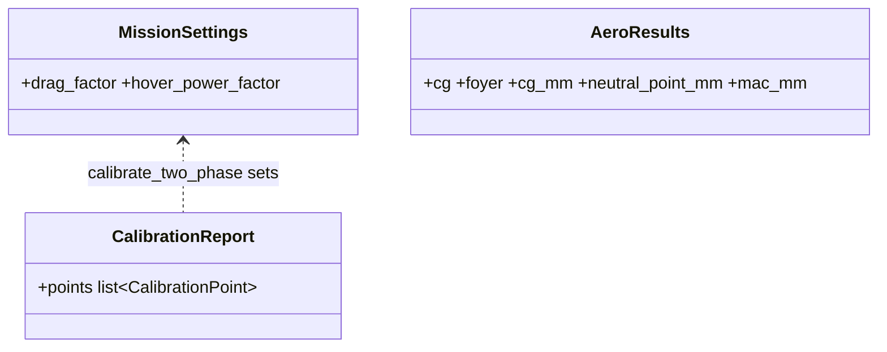

# GUI feedback of 2026-10-19

## Requirements

- First tab: no "generate the motor layout" menu; the motor layout is entered like the wing
  geometry, in a collapsed box under "Wing, stabiliser and fuselage".
- Battery: explain "Given quantity" (the battery is defined by its mass or by its capacity).
- Mission: one mission, the two-phase flight time; no scenario mode in the GUI (decision of
  the designer, 2026-10-19); the calibration on measured points moves to the two-phase model.
- Propeller sizing with only the rear motor tilting must size the rear motor at V1 / V2.
- CG: show the CG given by PredimRC next to the CG entered, warn when they differ.

## Entities

## Approach

1. First tab order: PredimRC folder → box "Wing, stabiliser and fuselage" → box "Motor layout"
   (table, tilt mask) → booms → CG and PredimRC CG → propulsion unit types → pre-selection,
   reference motors. The generator and `layouts.presets_for` are removed (the layout functions
   stay for the migration of format-1 files).
2. Battery: the given quantity is rendered first ("Battery defined by: its mass or its
   capacity"); only the matching field is shown, the other is kept hidden.
3. Two-phase only: Mission tab without the scenario expander, Run without the MVP solver,
   Results without the scenario section; `AppState.outdated` follows the two-phase result.
4. Two-phase calibration (`calibration.calibrate_two_phase`): hover point → k_h on the motor
   powers of the test data (`mission.hover_power_factor`); cruise point → k_D on the drag
   (`mission.drag_factor`); each factor by Brent's method on its bracket. `evaluate_two_phase`
   and the MDO discipline (two-phase mode) calibrate first; the report goes to
   `metadata["calibration"]` and the Test data tab.
5. CG: `AeroResults.cg_mm`, `neutral_point_mm` (`3-Geometrie!D30`, `D31`), `mac_mm`;
   `ui/cg_view.cg_check` gives the level (none, unset, ok, warning) and the text; threshold 2 %
   of the MAC; static margin implied by the CG entered SM' = (x_NP − x_CG) / MAC.

## Operations

### Update - `ui/app.py`, `ui/state.py`, `ui/test_data_view.py`, `ui/explanations.py`
### Create - `ui/cg_view.py`
### Update - `calibration.py`, `api.py`, `mdo/discipline.py`, `mission/two_phase.py`, `predimrc_wrapper.py`, `aircraft/project.py`, `aircraft/layouts.py`, `templates/tiltrotor.yaml`
### Create tests - `tests/test_feedback_2026_10_19.py`; app test of the first tab, mission and battery

## Norms

1. The project file keeps its `scenarios` (scenario mode of the API).
2. Every new quantity has a help entry.

## Safeguards

1. A project without calibration gives the same result as before (factors 1).
2. The project key ignores empty top-level values, so a page being drawn never marks the Run
   result as outdated.

## Implementation notes (2026-10-19)

- **Propeller sizing with only the rear motor tilting:** correct on the branch
  `feat/cost-reliability` (the cruise section lists the rear motor). The wrong unit was sized on
  `main` (before INC3-003, the tilt checkbox of the table did not update the roles). The units of
  the tricopter-with-wing template are renamed `front` / `rear` (the old name `tilt` of the front
  unit read like a role); the Hover and Propeller sizing tabs warn when the project changed since
  the last Run.
- **PredimRC CG reference:** checked on the reference wing — the MAC (183.96 mm) and its leading
  edge (11.21 mm from the root leading edge) derived from `C30`/`D30`/`C31`/`D31` equal the ones
  computed from the wing panels, so the PredimRC CG in mm uses the motor reference.
- **Tricopter-with-wing template:** its CG (20 mm, a 30 % static margin) did not match the 5 %
  static margin of its wing. CG set to the PredimRC CG (66.6 mm); the rear motor then carries
  41 % of the weight at x = 450 mm, more than any database motor can give at T/W 1.5, so the rear
  motor moves to x = 600 mm (tail boom) with the front motor and the T-Motor P12x4 (test data):
  one third of the weight per motor, feasible.
- **Tricopter template calibration:** its hover point (280 W at 1.87 kg) now also calibrates the
  two-phase result (k_h ≈ 1.09).
- Bisection replaced by Brent's method in the calibration (same results, 5× fewer
  evaluations).
