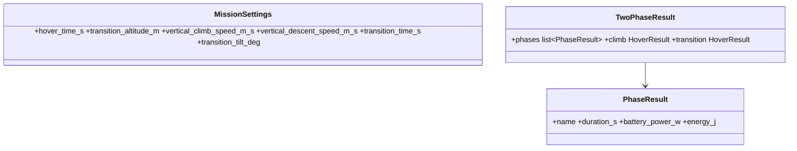

# Vertical phases, transition, masses (feedback of 2026-10-19, second list)

## Requirements

- Climb to and descent from a transition altitude, hover at that altitude, all shown.
- A transition with a tilt angle of the tilting motors: vertical thrust T·sin θ, power margin
  of those motors, energy counted.
- Cable masses in the budget and in the Power chain tab; a mass recap by component; the
  battery mass ↔ capacity link explained.
- Hover chart (surrogate curves in grams while the points were in N), cruise charts limited
  to 1.5 × V2, margin names explained.

## Entities

## Approach

1. `TwoPhaseEvaluation.hover(climb_speed_m_s, tilt_deg)`: the same balance of forces and
   moments; climb factor k_c per rotor on the power; tilting motors at F / sin θ.
2. `solve`: phases climb (h / v_c), hover (t_h), transition (t_tr, winged), descent (h / v_d);
   E_left = E_avail − Σ P_j·t_j; flight time Σ t_j + t_c; margins over hover and climb, a
   separate transition margin; battery C-rate and data coverage over every vertical point.
3. Gauges sized for the motor I_max (`wiring.default_gauges`) instead of the hover currents:
   the cruise chain used thinner cables than the hover chain before (same cables).
4. Cable mass (`wiring.conductor_mass_g_per_m`, `cable_rows_mass`, `wiring_mass_kg`) in the
   mass budget; recap `ui/mass_view.py`.
5. Power budget: hover, climb, transition, V1, V2 (useful power in climb
   T·(v_c/2 + √((v_c/2)² + v_h²))).

## Implementation notes (2026-10-19)

- Default transition tilt 60°: at 45° the tilting motors of the tricopter-with-wing template
  reach their current limit (margin −0.2 %); at 60° the margin is +18 %.
- The tricopter template keeps its measured 1870 g: the frame item loses the 38.3 g of the
  computed cables. The quadplane and tricopter-with-wing templates were at their T/W limit:
  their battery goes from 600 to 500 g and from 450 to 380 g to stay feasible with the
  cables (T/W margin 2.6 % and 2.3 %).
- The climb power factor applies to the surrogate power at the bus voltage of the climb
  (slightly lower), so climb / hover power equals k_c to 1e-4, not exactly.
- Mass per metre of RC silicone wire: copper + silicone wall linear in the gauge through the
  two Pimoroni wires (20 and 14 AWG), 65 / 43 / 28 / 18 / 11 / 7 / 4 g/m from 10 to 22 AWG.
