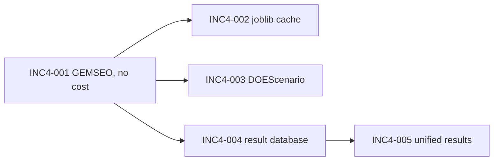

# predim-vtol — Increment 4: review of 2026-11-18, leaner MDO, result database

The review of 2026-11-18 (module MDO, PredimRC cache, run provenance) and the question of a
deployed Streamlit app ask for a leaner code base and for results that can live elsewhere
than on the local disk. Requirement identifiers are those of the full specification
(`spdd/requirements/`); this folder holds the increment statements and the REASONS
canvases.

Status: **in progress** — INC4-001 merged, INC4-002 implemented on its branch; INC4-003 to INC4-005 to come.

## Review of 2026-11-18 and where it goes

| Remark | Decision (2026-11-21) | Requirement | Canvas |
|---|---|---|---|
| GEMSEO is optional in 4 source and 5 test files | GEMSEO is a main dependency, the `mdo` extra and every optional branch go | REQ-NFR-008 | INC4-001 |
| Cost models | Removed, no deprecation (breaking change) | REQ-COST-001, -002 | INC4-001 |
| Reliability (motor-out hover) | Removed with the motor `spin` field, no deprecation | REQ-COST-003 | INC4-001 |
| Encode/decode around the GEMSEO `HDF5Cache` in `aero/cache.py` | Replaced by `joblib.Memory` (option B) | REQ-MDO-005 | INC4-002 |
| Exploration samples and loops by hand | GEMSEO `DOEScenario`; categorical choices stay an outer loop | REQ-MDO-007 | INC4-003 |
| Hashes of the reference data linked to the runs | Kept as is (strong test–computation link); only `prices` goes | REQ-UI-013, REQ-NFR-004 | — |
| Results on the local disk only; deployed app shared by all visitors | `ResultDatabase` with a folder and an in-memory implementation | REQ-NFR-009 | INC4-004 |
| Runs and studies are two silos, two studies at most compared | Study points in the run collection | REQ-MDO-009, REQ-UI-014 | INC4-005 |

## Definition of done

1. `tox -e check` and `tox -e py312` pass; no `importorskip("gemseo")` left, no `mdo` extra.
2. A project file with a `cost` block or a motor `spin` loads, both dropped; a stored run
   with `cost_*` and `motor_out_tw` outputs is still listed and compared.
3. A geometry evaluated twice starts Excel once; a new workbook or cache version opens a
   new cache folder.
4. A 2 × 2 × 5 exploration through `DOEScenario` gives 20 rows, infeasible points flagged.
5. Folder → memory → zip → folder gives the same files; the tests of `tests/runs` and
   `tests/mdo/test_studies.py` pass unchanged on `FolderDatabase`.
6. With `PREDIM_VTOL_HOSTED=1`, two sessions do not see each other's runs and nothing is
   written under the studies root nor `~/.predim_vtol`; a folder imported then exported as a
   zip reloads identically in the local app, user data included, with the same data hashes.
7. A run and the points of several studies are compared in one table and one figure.

## Work packages (in order)

| Canvas | Branch | Package | Exit criterion |
|---|---|---|---|
| INC4-001 | `refactor/gemseo-required-no-cost` | [Refactor] GEMSEO mandatory, cost and reliability removed | DoD 1–2 |
| INC4-002 | `refactor/joblib-aero-cache` | [Refactor] aero — PredimRC cache on `joblib.Memory` | DoD 3 |
| INC4-003 | `refactor/doe-scenario` | [Refactor] mdo — exploration through `DOEScenario` | DoD 4 |
| INC4-004 | `feat/result-database` | [Feat] runs — `ResultDatabase`, folder and memory, hosted mode | DoD 5–6 |
| INC4-005 | `feat/unified-results` | [Feat] runs — study points in the run collection, projects | DoD 7 |

One pull request per package, each from `main` once its predecessor is merged.

## Decisions taken (2026-11-21)

- GEMSEO is mandatory: `gemseo[all]` in the main dependencies, which caps xlwings at
  0.33.16 for every user.
- Cost and reliability are removed without deprecation: the tool is little used yet. Old
  project files lose their `cost` block and motor `spin` on load; stored runs keep their
  frozen `cost_*` and `motor_out_tw` outputs, no longer produced.
- PredimRC cache on `joblib.Memory`: the current HDF5 cache is not migrated (about 30 s of
  Excel to refill 102 entries); the `predimrc_cache` setting names a folder.
- The data hashes of the runs and studies stay as they are.
- Result database: the database stores records (an id and named files as bytes), never
  Python objects; `RunStore` and `StudyStore` keep their formats. The method writing a new
  complete record is `write`; `replace` rewrites one file (renaming only).
- Hosted mode: results and user data live in the Streamlit session, imported from a folder
  (`st.file_uploader(accept_multiple_files="directory")`) and exported as a zip with the
  same layout as on disk. The PredimRC (Excel) backend is not available there.

## Out of increment 4

Splitting `evaluate_two_phase` into coupled GEMSEO disciplines (a real MDA), mixed-variable
optimisation beyond the enumeration of the categorical choices, an index (SQLite or Parquet)
of the stored records.
