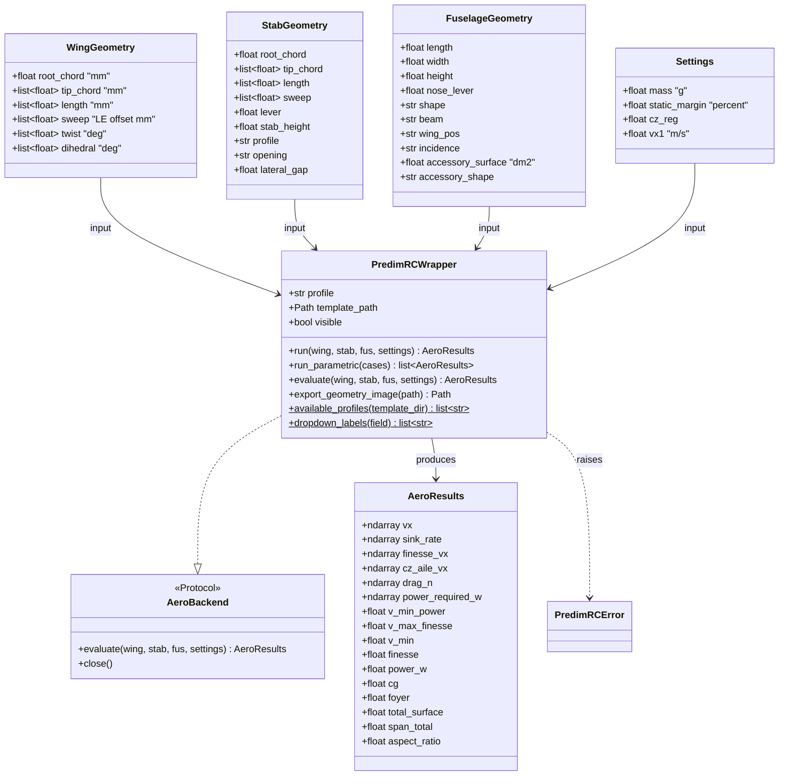

# Harden the PredimRC wrapper as the aero backend of the pre-sizing tool

## Requirements

- Make `PredimRCWrapper` a reliable, repeatable aero backend: never modify the
  template, apply every input, accept drop-down labels, and keep one Excel session for
  many evaluations.
- Extend the outputs with the drag and required power versus speed and the
  characteristic speeds needed by the mission solver.
- Expose the backend through a small interface so that callers (aircraft, mission,
  GEMSEO, GUI) never touch Excel cells.
- Boundary: PredimRC stays the aero model (Excel in the loop); no re-implementation.
  Excel and Windows are required only for this module.

## Entities

## Approach

1. Template safety and session reuse:
   - On `__enter__`, copy the template workbook to a temporary directory
     (`tempfile.mkdtemp`) and open the copy; on `__exit__`, close without saving, quit
     Excel and delete the copy, also on exception.
   - One `xw.App` and one book per wrapper instance; `run()` may be called any number
     of times; `calculate()` after writing.
2. Inputs:
   - Write every `Settings` field, including `cz_reg` (cell `E31` of `3-Geometrie`, to
     confirm in the workbook) and `vx1` at its actual cell (confirm `Calculs1!AB29` vs
     `3-Geometrie!AB29` by reading the workbook formulas).
   - Drop-down fields accept the PredimRC label; the allowed labels are read once from
     the data validation lists of the workbook (`Range.api.Validation.Formula1`) and
     cached; unknown label → `PredimRCError` with the allowed list.
   - `static_margin` is in percent (5.0 for 5 %), `sweep` is the leading-edge offset in
     mm: fix the docstrings and the sandbox script.
3. Outputs:
   - Derive drag from the PredimRC speed polar: `drag_n = mass_kg * g * |sink_rate| / vx`
     and `power_required_w = drag_n * vx`; if the workbook exposes Cx columns in
     `Calculs1`, read them and check consistency (≤ 1 %).
   - `v_min_power` = argmin of `power_required_w`, `v_max_finesse` = argmax of
     `finesse_vx`, `v_min` = lowest valid speed of the polar (stall side).
4. Airfoils:
   - `available_profiles()` scans `template_dir` for `PredimRC_*.xls*` and maps
     `PredimRC_<NAME>.xls[m]` → `<NAME>`; `PROFILE_FILES` becomes the result of this scan.
5. Geometry image (Could):
   - `export_geometry_image(path)` exports the drawing area of `3-Geometrie` to PNG via
     xlwings (`sheet.charts[...]` `to_png()` or `Range.to_png()`); if the workbook draws
     the plane in a way that cannot be exported, raise `NotImplementedError` with a
     clear message — the GUI falls back to its own plot.
6. Errors and logging:
   - COM errors are wrapped in `PredimRCError` with the cell being written/read.
   - Replace `print` by the module `logging` logger.

## Structure

### Inheritance Relationships
1. `AeroBackend` is a `typing.Protocol` with `evaluate()` and `close()`.
2. `PredimRCWrapper` implements `AeroBackend` (`evaluate` = `run`), and is a context
   manager.
3. `PredimRCError` extends `RuntimeError`.

### Dependencies
1. `PredimRCWrapper` depends on `xlwings`, `numpy`, `tempfile`, `shutil`.
2. Later modules (`aircraft`, `mission`) depend only on `AeroBackend` and
   `AeroResults`.

### Layered Architecture
1. Input layer: geometry and settings dataclasses (PredimRC units).
2. Adapter layer: `PredimRCWrapper` (cell mapping, Excel session).
3. Output layer: `AeroResults` (SI for the new fields: N, W, m/s).

## Operations

### Update module - `src/predimrc_wrapper/predimrc_wrapper.py`
1. Fix the module docstring example (`root_chord` scalar, labels for drop-downs,
   `static_margin=5.0`).
2. Add `class PredimRCError(RuntimeError)`.
3. Add `class AeroBackend(Protocol)`: `evaluate(wing, stab, fus, settings) -> AeroResults`,
   `close() -> None`.
4. Add `available_profiles(template_dir: Path) -> dict[str, Path]` (module function):
   glob `PredimRC_*.xls*`, key = stem without the `PredimRC_` prefix.
5. `PredimRCWrapper.__init__(profile, template_dir="./profiles", visible=False)`:
   - resolve the path with `available_profiles`; unknown profile → `ValueError` listing
     available ones.
6. `__enter__`:
   - `self._tmpdir = Path(tempfile.mkdtemp(prefix="predimrc_"))`; copy template there;
   - open `xw.App(visible=self.visible, add_book=False)`, `display_alerts=False`,
     `screen_updating=False`; open the copy.
7. `__exit__`:
   - `self._wb.close()` without `save()`; `self._app.quit()` in `finally`;
     `shutil.rmtree(self._tmpdir, ignore_errors=True)`.
8. `_dropdown_labels(cell: str) -> list[str]`:
   - read `self._geom[cell].api.Validation.Formula1`; if it is a range reference,
     read the range values; if a comma list, split; cache per cell.
9. `_write_label(cell: str, label: str, field: str)`:
   - check `label in self._dropdown_labels(cell)` else raise `PredimRCError(f"{field}: '{label}' not in {labels}")`; write.
10. `_write_stab`, `_write_fuselage`: use `_write_label` for `profile` (H19), `opening`
    (C20), `shape` (G24), `beam` (G25), `wing_pos` (C26), `incidence` (E26),
    `accessory_shape` (G26).
11. `_write_trapeze`: remove the debug print.
12. `_write_settings`: write `mass` (C33), `static_margin` (C29), `cz_reg` (cell
    confirmed by inspection, expected `E31`), `vx1` (cell confirmed by inspection).
13. `_read_outputs(mass_g, vx1)`:
    - after NaN filtering, compute `drag_n`, `power_required_w`, `v_min_power`,
      `v_max_finesse`, `v_min`; add them to `AeroResults`;
    - `power_w` uses `power_required_w` interpolated at `vx1`.
14. `evaluate = run` alias; `close()` calls `__exit__(None, None, None)`.
15. `export_geometry_image(path: Path) -> Path`: export as described in Approach 5.
16. Wrap every cell write/read in a helper `_set(sheet, cell, value)` / `_get(...)`
    which converts `pywintypes.com_error` into `PredimRCError`.

### Update dataclasses
1. `StabGeometry.opening: str` (label of the drop-down), `lever: float`.
2. `AeroResults`: add `drag_n: np.ndarray`, `power_required_w: np.ndarray`,
   `v_min_power: float`, `v_max_finesse: float`, `v_min: float`, with docstring units.
3. Field comments state units: `sweep` = leading-edge offset (mm).

### Update script - `sandbox/main.py`
1. Use labels for drop-downs, `lever=360.0`, `static_margin=5.0`, `vx1=12.0`.

### Create tests - `tests/aero/test_predimrc_wrapper.py`
1. `conftest.py`: fixture `excel_available` (try `xw.App` once) and marker `slow`;
   skip when unavailable.
2. `test_template_unchanged` (slow): hash before/after `run`.
3. `test_reference_case` (slow): `tricoptere_short_2` inputs → `total_surface ≈ 30.80`,
   `span_total ≈ 1825`, `aspect_ratio ≈ 9.83`, `cg ≈ 30.1`, within 0.5 %.
4. `test_settings_written` (slow): read back `cz_reg`, `vx1`.
5. `test_invalid_label` (slow): raises `PredimRCError`.
6. `test_drag_consistency` (fast, synthetic arrays through a pure helper
   `_derive_drag(vx, sink_rate, mass_g)`).
7. `test_available_profiles` (fast): temporary folder with fake files.

## Norms

1. Keep the dataclass style of the module; new comments and docstrings in English,
   Google style, units in every field comment.
2. PredimRC units (mm, g, dm², %) stay in the input dataclasses; new outputs are SI.
3. Use `logging.getLogger(__name__)`; no `print`.
4. Exceptions: `PredimRCError` for workbook problems, `ValueError` for invalid Python
   inputs.
5. Excel tests marked `@pytest.mark.slow` and skipped without Excel.

## Safeguards

1. Functional: the template file in `profiles/` is byte-identical after any run,
   including a run raising an exception.
2. Functional: the reference case reproduces the screenshot values within 0.5 %.
3. Performance: after the first evaluation, one evaluation ≤ 2 s on a standard
   laptop; no Excel restart between evaluations.
4. Integration: public names `PredimRCWrapper`, `WingGeometry`, `StabGeometry`,
   `FuselageGeometry`, `Settings`, `AeroResults`, `run`, `run_parametric` keep their
   meaning; only `StabGeometry.opening` changes type (label).
5. Technical: no Excel process left after the context manager exits (checked by
   test via `xw.apps.count`).
6. Data: drop-down labels compared exactly (accents included, e.g. `"Profilée"`).
7. Cell addresses not yet confirmed (`cz_reg`, `vx1`, possible Cx columns) are
   confirmed by reading the workbook before writing code; any mismatch is reported in
   the canvas through `/spdd-sync`.
