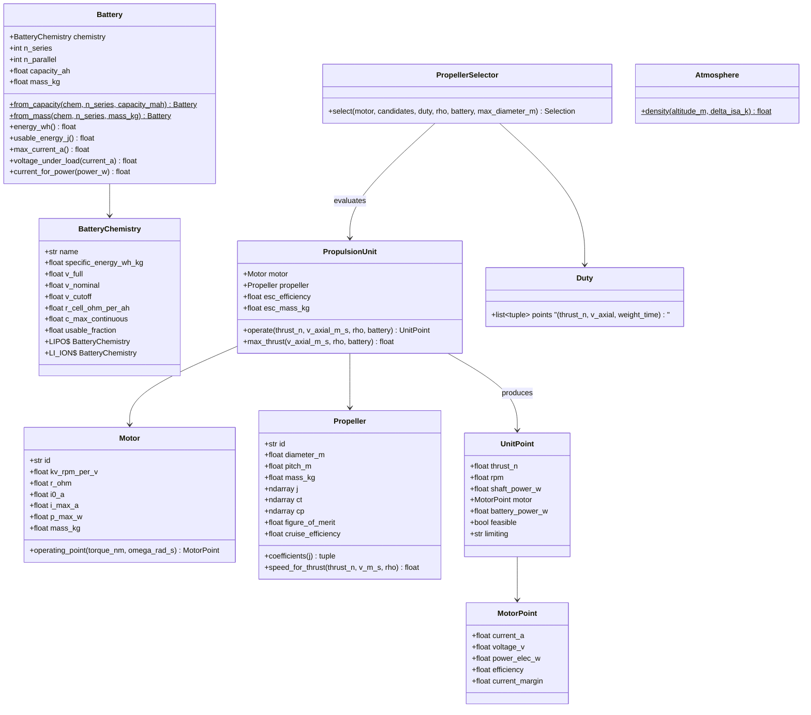

# Battery, motor, propeller and propulsion-unit models

## Requirements

- Model the electric propulsion chain of an RC VTOL (battery → ESC → motor →
  propeller) at pre-sizing fidelity, so that hover and cruise battery powers and
  operating limits are computed from published component data.
- Select automatically the propeller minimising the battery power of a given duty,
  while letting the user impose one.
- Boundary: pure Python, SI units, no Excel; no transient, thermal or blade-element
  modelling.

## Entities

## Approach

1. Battery:
   - Pack-level specific energy (defaults LiPo 150 Wh/kg, Li-ion 200 Wh/kg), cell
     voltages (LiPo 4.2/3.7/3.3 V, Li-ion 4.2/3.6/2.8 V), maximum continuous C (LiPo
     30 C, Li-ion 8 C), usable fraction (LiPo 0.85, Li-ion 0.9), internal resistance per
     cell normalised by capacity (LiPo 0.010 Ω·Ah, Li-ion 0.040 Ω·Ah); all overridable.
   - Energy = n_s · v_nominal · capacity; mass = energy / specific energy.
   - Voltage under load = n_s · (v_nominal − I · r_cell / capacity_ah_per_parallel);
     current for a power P solves V(I)·I = P (quadratic, smallest root; no root →
     infeasible).
2. Motor (3-constant model):
   - kv_si = kv · 2π/60; kt = 1/kv_si; I = Q·kv_si + i0; V = ω/kv_si + I·R;
     P_elec = V·I; η = Q·ω / P_elec; current_margin = 1 − I/i_max.
3. Propeller:
   - With tables: CT(J), CP(J) interpolated (J = V/(nD)); T = CT ρ n² D⁴,
     P = CP ρ n³ D⁵. `speed_for_thrust` solves T(n) = target by `scipy.optimize.brentq`
     on n ∈ [1, n_max].
   - Without tables: hover via momentum theory P = T^1.5 / (FM · sqrt(2ρA)) with
     FM default 0.65; rotor speed estimated from a static CT default 0.10; cruise
     shaft power P = T·V / η_cruise (default 0.70).
4. Propulsion unit:
   - Chain: thrust → (n, shaft power) → motor (Q = P/ω) → electric power →
     battery power = P_elec / η_esc (default 0.95).
   - Feasibility: motor current ≤ i_max, voltage ≤ battery voltage under load at the
     unit's share of the current, rpm finite; `limiting` names the first violated limit.
   - `max_thrust`: thrust at full battery voltage under load and motor i_max (bisection).
5. Propeller selection:
   - Candidates = propellers whose diameter ≤ `max_diameter_m` and within the motor
     recommended propeller range (if given); duty = weighted list of operating points
     (hover only for lift rotors; hover + cruise for tilt-rotor; cruise for the cruise
     unit); score = Σ weight · battery_power, infeasible candidates excluded;
     return best + ranked table. An imposed propeller bypasses the search but is still
     checked.
6. Atmosphere: ISA density with altitude and temperature offset.

## Structure

### Inheritance Relationships
1. All entities are `@dataclass` (frozen for chemistry, motor, propeller).
2. `PropulsionError` extends `ValueError` for physically impossible inputs.

### Dependencies
1. `PropulsionUnit` depends on `Motor`, `Propeller`, `Battery`.
2. `PropellerSelector` depends on `PropulsionUnit`; it receives candidate lists
   (from the database of SPEC-003, or user lists).
3. Only `numpy` and `scipy` are needed (add `scipy` to dependencies).

### Layered Architecture
1. Component layer: `battery.py`, `motor.py`, `propeller.py`, `atmosphere.py`.
2. Assembly layer: `unit.py` (PropulsionUnit, UnitPoint).
3. Decision layer: `selection.py` (Duty, PropellerSelector, Selection).

## Operations

### Create package - `src/predimrc_wrapper/propulsion/`
1. `__init__.py` re-exporting the public classes.

### Create module - `atmosphere.py`
1. `density(altitude_m: float = 0.0, delta_isa_k: float = 0.0) -> float`:
   ISA troposphere, T = 288.15 − 0.0065 h + ΔT, p = 101325 (1 − 2.25577e-5 h)^5.25588,
   ρ = p / (287.053 T). Altitude > 11 000 m → `PropulsionError`.

### Create module - `battery.py`
1. `BatteryChemistry` frozen dataclass + constants `LIPO`, `LI_ION`, dict
   `CHEMISTRIES = {"lipo": LIPO, "li-ion": LI_ION}`; `replace()` for overrides.
2. `Battery` dataclass (`chemistry, n_series, capacity_ah, mass_kg, n_parallel=1`);
   `__post_init__` validates positivity.
3. `from_capacity(chem, n_series, capacity_mah, n_parallel=1)`:
   mass = n_s · v_nominal · capacity_ah / specific_energy.
4. `from_mass(chem, n_series, mass_kg)`: capacity_ah = mass · specific_energy /
   (n_s · v_nominal).
5. `energy_wh()`, `usable_energy_j()` (= energy · usable_fraction · 3600),
   `max_current_a()` (= c_max · capacity_ah).
6. `voltage_under_load(current_a)`; `current_for_power(power_w)`: solve
   R·I² − V0·I + P = 0 with R = n_s·r_cell/capacity_ah, V0 = n_s·v_nominal; no real
   root → `math.inf`.

### Create module - `motor.py`
1. `Motor` frozen dataclass (fields above + `recommended_cells: tuple[int, int] | None`,
   `prop_range_in: tuple[float, float] | None`).
2. `MotorPoint` dataclass.
3. `Motor.operating_point(torque_nm, omega_rad_s) -> MotorPoint` per Approach 2;
   torque < 0 → `PropulsionError`.

### Create module - `propeller.py`
1. `Propeller` frozen dataclass; `has_tables` property; `area` property.
2. `coefficients(j: float) -> tuple[float, float]`: `np.interp`; j beyond the table →
   last values with a logged warning; CT clipped at ≥ 0.
3. `speed_for_thrust(thrust_n, v_m_s, rho) -> float` (rev/s): brentq on
   f(n) = CT(V/(nD)) ρ n² D⁴ − T; bracket [n_low, 1000]; no root → `math.inf`.
4. `shaft_power(n, v_m_s, rho) -> float`.
5. `hover_power_momentum(thrust_n, rho) -> float` for the fallback.

### Create module - `unit.py`
1. `UnitPoint` dataclass.
2. `PropulsionUnit.operate(thrust_n, v_axial_m_s, rho, battery, n_units_sharing) -> UnitPoint`:
   - n via propeller (tables or fallback), shaft power, ω = 2πn, Q = P/ω;
   - motor point; battery power = P_elec / esc_efficiency;
   - voltage check: motor voltage ≤ battery.voltage_under_load(total current estimate
     = n_units_sharing · motor current);
   - set `feasible` and `limiting` ∈ {"motor_current", "motor_power", "voltage",
     "thrust"}.
3. `max_thrust(v_axial_m_s, rho, battery) -> float`: bisection on thrust until
   infeasible.

### Create module - `selection.py`
1. `Duty` dataclass: list of `(thrust_n, v_axial_m_s, weight)`.
2. `Selection` dataclass: `best: Propeller`, `ranking: list[tuple[str, float, bool]]`.
3. `PropellerSelector.select(motor, candidates, duty, rho, battery, max_diameter_m,
   n_units, esc_efficiency=0.95, imposed: Propeller | None = None) -> Selection`:
   filter, score, sort; no feasible candidate → `PropulsionError` listing limiting
   reasons.

### Create tests - `tests/propulsion/`
1. `test_battery.py`: capacity↔mass round trip; usable energy; current_for_power
   infeasible beyond the max power.
2. `test_motor.py`: zero torque → I = i0; efficiency < 1; margin sign.
3. `test_propeller.py`: momentum power with FM = 1 equals T^1.5/sqrt(2ρA);
   speed_for_thrust inverse of thrust.
4. `test_unit.py`: battery power ≥ shaft power; undersized motor → infeasible
   "motor_current".
5. `test_selection.py`: imposed propeller kept; best = argmin of scores; diameter
   bound respected.
6. `test_validation.py` (after SPEC-003 data): two T-Motor test-table points within
   ±10 % on current and power.

## Norms

1. SI units everywhere; unit suffixes in names (`_m`, `_kg`, `_w`, `_a`, `_v`,
   `_rad_s`) when ambiguous; mAh and inches only in factory methods with explicit
   names.
2. Dataclasses with `__post_init__` validation; frozen for component data.
3. Pure functions, no I/O, no global state; `logging` for warnings.
4. Docstrings Google style with the equations used.
5. Fast tests only (no Excel).

## Safeguards

1. Functional: with FM = 1 and no tables, hover power equals ideal momentum power
   within 1e-9 relative.
2. Functional: energy conservation along the chain — battery power ≥ electric power ≥
   shaft power ≥ T·V (cruise).
3. Business rule: an infeasible point never returns a finite battery power marked
   feasible.
4. Business rule: the imposed propeller is always used, even if not optimal; it is
   still checked and its infeasibility reported.
5. Performance: one `operate()` call ≤ 1 ms; a selection over 50 candidates ≤ 100 ms.
6. Data: default chemistry values documented with their source in the module
   docstring; overrides never mutate the constants.
7. Validation: REQ-NFR-005 test passes once SPEC-003 data exist; otherwise skipped with
   a clear reason.
