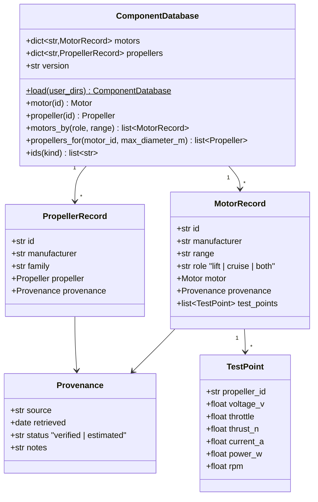

# Motor and propeller database

## Requirements

- Ship a curated, traceable database of commercial motors and propellers so that the
  propulsion models and the automatic propeller selection work out of the box.
- Let the user add components by dropping data files, without code.
- Boundary: data files and a loader; no web scraping at run time. Data are collected
  once, during generation, from manufacturer pages.

## Entities

## Approach

1. Content (initial scope, ~8–12 motors per range):
   - Lift: T-Motor MN series (e.g. MN3508, MN4010, MN4014, MN5008, MN501-S), T-Motor
     Antigravity (MN4006, MN5006, MN6007), SunnySky X series (X2814, X3508S, X4110S,
     X4120).
   - Cruise: T-Motor AT series (AT2312, AT2814, AT2820, AT3520).
   - Propellers: T-Motor carbon (P/MF series, 12–24 in) and APC Thin Electric /
     Multirotor (10–20 in), with CT/CP vs J from APC performance files (`PER3_*.dat`)
     and static coefficients derived from T-Motor test tables.
2. Collection during `/spdd-generate`: fetch each manufacturer product page / data
   sheet with WebFetch; record URL and date; motors' Rm and I0 when absent are
   estimated from the test tables (fit of the 3-constant model) and marked
   `estimated`. Pages that cannot be reached are listed in `data/README.md` instead of
   inventing values.
3. Format:
   - One YAML file per range in `src/predimrc_wrapper/data/motors/` (list of records,
     manufacturer units: Kv rpm/V, mΩ, g, A, W, inches).
   - One YAML file per propeller family in `data/propellers/`, CT/CP tables inline
     (`j: [...]`, `ct: [...]`, `cp: [...]`).
   - Loader converts to the SI dataclasses of SPEC-002.
4. User extension: extra directories from the argument `user_dirs` and the environment
   variable `PREDIMRC_DATA_DIRS` (os.pathsep-separated); a user id equal to a shipped
   id overrides it with a logged warning.
5. Versioning: `data/VERSION` (date string) exposed as `ComponentDatabase.version`
   for reproducibility.

## Structure

### Inheritance Relationships
1. Records are `@dataclass(frozen=True)`; they wrap the SPEC-002 `Motor` and
   `Propeller`.
2. `DatabaseError` extends `ValueError`.

### Dependencies
1. `ComponentDatabase` depends on `pyyaml` (new dependency) and `propulsion`.
2. `PropellerSelector` (SPEC-002) receives `ComponentDatabase.propellers_for(...)`.
3. GUI and GEMSEO use `ids(kind)` for choice lists and categorical mappings.

### Layered Architecture
1. Files layer: YAML data + `VERSION` + `README.md` (sources, coverage, gaps).
2. Loader layer: `database.py` (parse, validate, convert units).
3. Query layer: `ComponentDatabase` methods.

## Operations

### Create data - `src/predimrc_wrapper/data/`
1. `motors/tmotor_mn.yaml`, `motors/tmotor_antigravity.yaml`,
   `motors/sunnysky_x.yaml`, `motors/tmotor_at.yaml`.
2. `propellers/tmotor_carbon.yaml`, `propellers/apc.yaml`.
3. `VERSION`, `README.md` (schema, units, sources table, estimated entries).
4. Declare package data in `pyproject.toml` (`[tool.setuptools.package-data]`).

### Create module - `src/predimrc_wrapper/data/database.py`
1. `Provenance`, `TestPoint`, `MotorRecord`, `PropellerRecord` dataclasses.
2. `_parse_motor(raw: dict, file: Path) -> MotorRecord`: required keys `id`,
   `manufacturer`, `range`, `role`, `kv`, `rm_mohm`, `i0_a`, `i_max_a`, `p_max_w`,
   `mass_g`, `source`, `retrieved`, `status`; convert units; missing key →
   `DatabaseError(f"{file}: {id}: missing {key}")`.
3. `_parse_propeller(raw, file) -> PropellerRecord`: `diameter_in`, `pitch_in`,
   `mass_g`, optional `j`, `ct`, `cp` (same length, j increasing) or `fm`,
   `cruise_efficiency`.
4. `ComponentDatabase.load(user_dirs: list[Path] | None = None) -> ComponentDatabase`:
   shipped files via `importlib.resources`, then user dirs, then env var.
5. Queries: `motor(id)`, `propeller(id)` (unknown id → `KeyError` with close matches
   from `difflib`), `motors_by(role=None, range=None)`, `propellers_for(motor_id,
   max_diameter_m)` (filter on the motor `prop_range_in` if set), `ids(kind)` sorted.
6. Module-level cached accessor `default_database()` (`functools.cache`).

### Create tests - `tests/data/test_database.py`
1. All shipped files load; every record has a provenance.
2. Each required range has ≥ 4 motors; propellers with tables have monotonic J.
3. User dir override and env var.
4. Missing field raises `DatabaseError` naming file and id.

## Norms

1. Data files keep manufacturer units, with the unit in the key name (`mass_g`,
   `rm_mohm`, `diameter_in`).
2. No value without source; `estimated` values explain the method in `notes`.
3. YAML: one list of records per file, ids lower-case kebab (`tmotor-mn4014-330kv`).
4. Loader errors are explicit (file, id, key).

## Safeguards

1. Data: no record is shipped without `source` and `retrieved`; test-enforced.
2. Data: values are copied from the source, never invented; a range that cannot be
   documented is reported in `data/README.md` and the canvas updated via
   `/spdd-sync`.
3. Legal: only numerical specifications are stored (no copied text or images).
4. Performance: full database load ≤ 200 ms.
5. Compatibility: adding a field to the YAML schema keeps old user files valid
   (optional fields have defaults).
