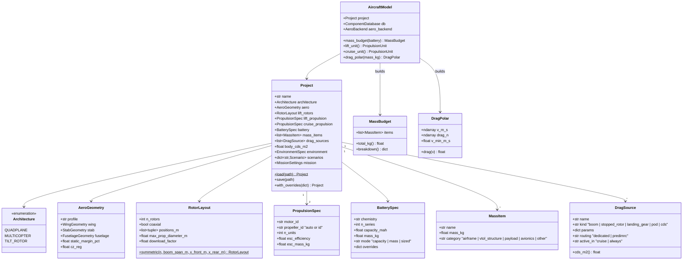

# VTOL configurations, mass budget, parasitic drag sources and project file

## Requirements

- Describe a complete VTOL design — architecture, rotor layout, components, mass
  items, parasitic drag sources and aero geometry — as one project, stored in one
  YAML file shared by the API, the GUI and GEMSEO.
- Turn a project into the physical quantities the mission needs: total mass and its
  breakdown, propulsion units for lift and cruise, and the drag versus speed including
  parasitic drag (PredimRC for wing-borne aircraft, body drag for multicopters).
- Boundary: quadplane, multicopter, tilt-rotor; no tailsitter; no structural sizing
  (structure masses are user inputs).

## Entities

## Approach

1. Project model:
   - Dataclasses nested in `Project`; YAML (de)serialisation via `dataclasses.asdict`
     and explicit `from_dict` per class; enums by value; file header records
     `format_version`, tool version and database version (REQ-NFR-004).
   - Units in the file are user units with explicit key suffixes (`_mm`, `_g`, `_mah`);
     conversion to SI at load.
   - `with_overrides({"battery.n_series": 6, "wing.tip_chord.2": 150, ...})` returns
     a modified deep copy: the single mechanism for GEMSEO and GUI parameter changes.
2. Architectures:
   - Quadplane: lift propulsion = `n_rotors` units used in hover, stopped in cruise
     (their stopped propellers and booms become drag sources); cruise propulsion = 1
     unit used in cruise, idle in hover.
   - Tilt-rotor: lift propulsion used in both phases (`n_units` cruise = lift count or
     a user subset), no separate cruise unit; tilt mechanism mass as a mass item.
   - Multicopter: lift propulsion only, `aero` absent, `body_cds_m2` required.
   - Coaxial pairs: lower rotor efficiency penalty 0.85 on thrust per power (default).
3. Mass budget:
   - User items + computed: motors (db mass × n), propellers, ESCs, battery.
   - The propeller mass uses the selected propeller (auto selection requires a first
     mass estimate: iterate selection ↔ mass at most 3 times, converge on the same id).
4. Drag:
   - Dedicated models (equivalent drag area CdS):
     boom = Cd 1.1 (cylinder, crossflow) × diameter × exposed length (default Cd
     override); stopped rotor = n_blades × 0.5 × chord_mean × R × Cd 0.05 aligned
     (user-settable); landing gear = Cd × frontal area (default Cd 1.0); pod = Cd 0.08
     × frontal area; `cds` = given value.
   - Routed to PredimRC: the sum of the frontal areas of routed sources is written to
     the fuselage accessory surface (dm²), with the accessory shape of the first routed
     source; mixing shapes → warning and use of the first; a user accessory already
     in `fuselage` is added.
   - Total drag D(V) = PredimRC drag at total mass (wing-borne) + ½ ρ V² Σ CdS of
     dedicated sources active in cruise. Density correction: PredimRC drag scaled by
     ρ/ρ0 at equal speed is not valid at fixed lift; instead, evaluate at equivalent
     airspeed and convert (V_true = V_eas · sqrt(ρ0/ρ)).
   - Multicopter: D(V) = ½ ρ V² body_cds (the tilt/trim is handled by the mission).
5. Aero backend caching: `AircraftModel` memoises PredimRC results on
   (geometry, mass rounded to 1 g, accessory) so the mission sizing loop does not
   re-evaluate identical points.

## Structure

### Inheritance Relationships
1. `Architecture` extends `enum.Enum`.
2. All project entities are dataclasses; `DragSource` kinds handled by a dispatch
   table of pure functions (no subclass hierarchy).
3. `ProjectError` extends `ValueError`.

### Dependencies
1. `AircraftModel` depends on `Project`, `ComponentDatabase` (SPEC-003),
   `PropulsionUnit`/`PropellerSelector` (SPEC-002), `AeroBackend` (SPEC-001).
2. `Project` depends only on the geometry dataclasses of SPEC-001 and `pyyaml`.
3. No import of `xlwings` outside `predimrc_wrapper.py`; the backend is injected.

### Layered Architecture
1. Data layer: `aircraft/project.py` (Project and nested specs, YAML I/O).
2. Physics layer: `aircraft/drag.py`, `aircraft/mass.py`.
3. Assembly layer: `aircraft/model.py` (AircraftModel).

## Operations

### Create module - `src/predimrc_wrapper/aircraft/project.py`
1. Dataclasses of the diagram with `__post_init__` checks: positive dimensions,
   multicopter ⇒ `aero is None` and `body_cds_m2 > 0`; quadplane ⇒
   `cruise_propulsion` set; tilt-rotor ⇒ `cruise_propulsion is None`.
2. `Project.from_dict(d) / to_dict()`; `load(path)` / `save(path)` with
   `yaml.safe_load` / `yaml.safe_dump(sort_keys=False)`; `format_version: 1`.
3. `with_overrides(overrides: dict[str, Any]) -> Project`: dotted paths, list
   indexes as integers; unknown path → `ProjectError` listing the valid prefixes.
4. `EnvironmentSpec(altitude_m=0, delta_isa_k=0)`; `MissionSettings(reserve_fraction=0.2,
   min_thrust_to_weight=1.5, avionics_power_w=5.0)`.
5. Example files: `examples/projects/quadplane_tricoptere.yaml` (reference geometry of
   the screenshot + 4 lift rotors), `multicopter_quad.yaml`, `tiltrotor.yaml`.

### Create module - `src/predimrc_wrapper/aircraft/drag.py`
1. `cds_m2(source: DragSource) -> float` dispatch on `kind`.
2. `predimrc_accessory(sources) -> tuple[float_dm2, str_shape]`.
3. `dedicated_cds(sources, phase) -> float`.

### Create module - `src/predimrc_wrapper/aircraft/mass.py`
1. `MassBudget` with `total_kg()`, `breakdown()` by category and by item.

### Create module - `src/predimrc_wrapper/aircraft/model.py`
1. `AircraftModel(project, db=None, aero_backend=None)`: default db =
   `default_database()`; backend required for wing-borne architectures when
   `drag_polar` is called (else `ProjectError`).
2. `battery(mass_kg: float | None = None) -> Battery` from `BatterySpec` (mode).
3. `lift_unit(mass_kg) -> PropulsionUnit`: auto selection with hover duty
   (thrust = m g k_dl / n), or imposed id.
4. `cruise_unit(drag_ref_n) -> PropulsionUnit` (quadplane) — auto selection with
   cruise duty at `v_max_finesse`.
5. `mass_budget(battery) -> MassBudget`, with the selection/mass iteration.
6. `drag_polar(mass_kg) -> DragPolar`: build PredimRC inputs (`Settings(mass=g,
   static_margin, cz_reg, vx1=v_ref)`, fuselage accessory from routed sources), call
   backend (memoised), add dedicated CdS; multicopter path without backend.

### Create tests - `tests/aircraft/`
1. `test_project.py`: round trip of the three example projects; overrides; invalid
   architecture combinations.
2. `test_drag.py`: boom and stopped rotor CdS formulas; routing sum.
3. `test_mass.py`: total = sum; breakdown categories.
4. `test_model.py`: with a fake `AeroBackend` returning a parabolic polar — drag
   polar adds dedicated CdS; multicopter without backend.
5. `test_model_excel.py` (slow): quadplane example through PredimRC.

## Norms

1. Same dataclass style as SPEC-001/002; English docstrings with units.
2. YAML keys snake_case with unit suffixes; SI inside objects.
3. Backend injected (dependency injection), never created inside physics code.
4. Explicit errors (`ProjectError`) naming the path in the project.

## Safeguards

1. Functional: `Project.load(p).save(q)`; `load(q) == load(p)` (round trip).
2. Business rule: total mass = Σ items exactly; no item counted twice (propellers
   and motors computed only if not given as user items with the same name).
3. Business rule: architecture invariants enforced at load (quadplane has a cruise
   unit, multicopter has no wing).
4. Integration: multicopter projects never import `xlwings` (test with the module
   blocked in `sys.modules`).
5. Performance: memoised PredimRC calls — re-evaluating the same mass costs no Excel
   call.
6. Data: the project file stores tool and database versions (REQ-NFR-004).
