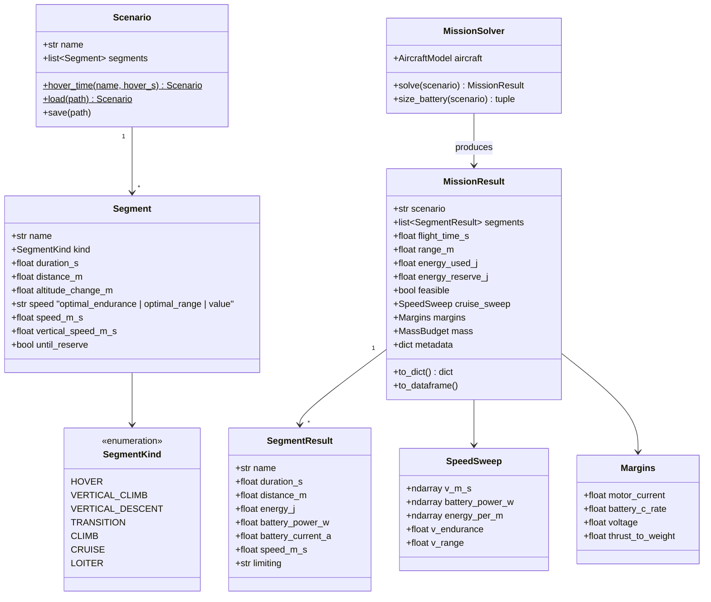

# Flight scenario solver

## Requirements

- Compute, for a project and a flight scenario, the flight time, range, energy per
  segment, optimal cruise speeds and operating margins — the outputs of interest of
  the tool.
- Offer the quick "hover time" mode and the battery sizing mode on top of the same
  solver.
- Provide the single entry point `evaluate(project, scenario)` used by the GUI and the
  GEMSEO discipline.
- Boundary: quasi-steady segments, constant mass, no wind, no transition dynamics.

## Entities

## Approach

1. Segment powers (battery power, W):
   - Hover: thrust per rotor = m g k_dl / n_lift → lift unit operating point; plus the
     idle cruise unit (0 W) and avionics power.
   - Vertical climb at Vc: induced velocity from momentum theory with climb,
     v_i = −Vc/2 + sqrt((Vc/2)² + v_h²); power ratio P/P_h = (Vc + v_i)/v_h applied to
     the hover shaft power, plus vertical body drag (Cd 1.0 × planform, default).
   - Vertical descent: hover power × 0.85 (default, user-settable; vortex-ring region
     not modelled).
   - Transition: duration × hover battery power × factor (default 1.0) — conservative
     placeholder model, documented as such.
   - Cruise / loiter: thrust = D(V) (SPEC-004 polar) → cruise unit (quadplane) or lift
     units with axial inflow (tilt-rotor); multicopter: trim T cos α = m g,
     T sin α = D_body(V), rotor power with Glauert induced velocity
     v_i = v_h² / sqrt((V cos α)² + (V sin α + v_i)²) solved by fixed point.
   - Climb at angle: cruise power at V + m g Vz / (η_prop η_motor η_esc) evaluated at
     the operating point.
2. Cruise speed sweep:
   - V grid = PredimRC polar speeds above `v_min × 1.2` (stall margin, settable) up to
     the max speed where the propulsion is feasible; battery power P(V); endurance
     speed = argmin P; range speed = argmin P/V; refined by parabolic interpolation.
3. Integration:
   - Each segment: energy = P × duration (duration from distance / speed or altitude
     change / vertical speed); "until reserve" segment gets the remaining usable energy
     minus the reserve; usable energy = battery usable energy × (1 − reserve_fraction).
   - Feasible ⇔ every segment feasible and energy used ≤ available.
4. Hover-time mode: `Scenario.hover_time(hover_s)` = vertical climb 30 m, hover
   (hover_s), cruise at optimal_range until reserve, vertical descent 30 m.
5. Margins: worst over segments of motor current margin, battery C margin
   (1 − I/I_max), voltage margin, and thrust-to-weight of the lift system
   (n · max_thrust / (m g)) − min ratio.
6. Battery sizing: unknown battery mass; residual = reserve_left(m_batt); solve with
   `brentq` on [0.05 m_empty, 3 m_empty]; each evaluation re-closes the mass budget
   and re-runs PredimRC through the memoised backend; no sign change → infeasible
   design reported with the best attempt.
7. Entry point `evaluate(project, scenario_names=None, backend=None) -> dict[str, MissionResult]`.

## Structure

### Inheritance Relationships
1. `SegmentKind` extends `enum.Enum`; dataclasses for the rest.
2. `MissionError` extends `RuntimeError`.

### Dependencies
1. `MissionSolver` depends on `AircraftModel` (SPEC-004) and propulsion (SPEC-002).
2. `evaluate()` creates the `AircraftModel` and opens a `PredimRCWrapper` only for
   wing-borne architectures when no backend is given.
3. `pandas` optional for `to_dataframe()` (imported lazily).

### Layered Architecture
1. Definition layer: `mission/scenario.py` (Segment, Scenario, YAML I/O).
2. Physics layer: `mission/powers.py` (segment power functions).
3. Solver layer: `mission/solver.py` (MissionSolver, sweep, sizing).
4. Facade: `predimrc_wrapper/api.py` (`evaluate`).

## Operations

### Create module - `src/predimrc_wrapper/mission/scenario.py`
1. `SegmentKind`, `Segment` with validation (exactly one of duration, distance,
   altitude change, until_reserve depending on kind).
2. `Scenario` with `hover_time()`, `load()`/`save()` (YAML), `from_dict`/`to_dict`.
3. Scenarios in `Project.scenarios` use the same dict format (REQ-MIS-006).

### Create module - `src/predimrc_wrapper/mission/powers.py`
1. `hover_power(aircraft, mass_kg, rho, battery) -> UnitPoint-like result`.
2. `vertical_climb_power(...)`, `vertical_descent_power(...)`, `transition_power(...)`.
3. `cruise_power(aircraft, mass_kg, v, rho, battery)` dispatch on architecture;
   `multicopter_forward_power(...)` with the Glauert fixed point (≤ 50 iterations,
   tol 1e-6).
4. `climb_power(..., v, vz)`.

### Create module - `src/predimrc_wrapper/mission/solver.py`
1. `MissionSolver(aircraft, battery)`.
2. `cruise_sweep(mass_kg) -> SpeedSweep`.
3. `solve(scenario) -> MissionResult`: resolve "optimal" speeds from the sweep,
   compute each segment, accumulate, fill margins, metadata (tool version, database
   version, project hash).
4. `size_battery(scenario) -> tuple[Battery, MissionResult]` per Approach 6.

### Create module - `src/predimrc_wrapper/api.py`
1. `evaluate(project, scenario_names=None, backend=None) -> dict[str, MissionResult]`;
   battery mode "sized" calls `size_battery`; the backend is closed only if created
   here.

### Create tests - `tests/mission/`
1. `test_scenario.py`: validation, YAML round trip, hover_time builder.
2. `test_powers.py`: vertical climb at Vc = 0 equals hover; multicopter at V = 0
   equals hover.
3. `test_solver.py` (fake aero backend): energy additivity; reserve respected; with
   constant efficiencies, v_endurance = aero min-power speed and v_range = max-L/D
   speed (within grid resolution); sizing hits the reserve within 1 %.
4. `test_api_excel.py` (slow): quadplane example project end to end.

## Norms

1. SI internally; results expose SI plus convenience properties (`flight_time_min`,
   `range_km`, `speed_kmh`).
2. Each simplified model (transition, descent) is documented with its assumption and
   its default factor, overridable in `MissionSettings`.
3. No hidden global state; the solver is deterministic.
4. Fast tests use a fake `AeroBackend`; Excel tests marked slow.

## Safeguards

1. Functional: sum of segment energies = energy used (1e-9 relative); flight time =
   sum of durations.
2. Business rule: the reserve is never consumed; "until reserve" ends exactly at it.
3. Business rule: an infeasible segment makes the mission infeasible and names the
   limiting segment and limit; results are still returned for diagnosis.
4. Business rule: cruise speeds are never below `1.2 × v_min` of the polar.
5. Performance: without battery sizing, one scenario evaluation needs one PredimRC
   call; with sizing, ≤ 15 PredimRC calls.
6. Reproducibility: `MissionResult.metadata` records tool version, database version
   and project hash.
