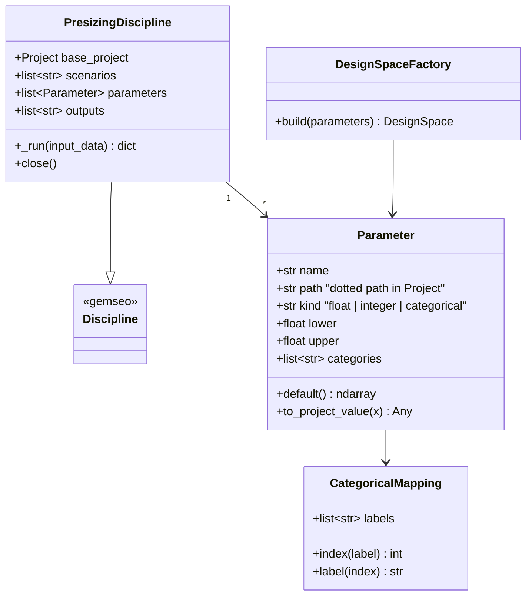

# GEMSEO discipline for exploration and optimisation

## Requirements

- Wrap the pre-sizing evaluation in a GEMSEO discipline so that designs can be
  explored (DOE over continuous, discrete and categorical parameters, several flight
  scenarios) and optimised under operating-margin constraints.
- Keep PredimRC in the loop economically: one Excel session, caching, sequential
  execution, failed points reported without stopping the study.
- Boundary: the discipline maps names ↔ project overrides and results; physics stays
  in SPEC-002/004/005.

## Entities

## Approach

1. Discipline:
   - Subclass of `gemseo.core.discipline.Discipline` (GEMSEO ≥ 6; the generation step
     checks the installed version and adapts the `_run` signature).
   - Inputs: one variable per `Parameter`, named by the user (e.g. `n_series`,
     `battery_mass`, `tip_chord_2`, `lift_propeller`), numeric arrays of size 1.
   - Outputs per scenario `s`: `flight_time_<s>` (min), `range_<s>` (km),
     `energy_margin_<s>` (fraction of usable energy left above reserve),
     `feasible_<s>` (0/1); global: `mass_total` (kg), `v_endurance`, `v_range` (m/s),
     `margin_motor_current`, `margin_battery_c`, `margin_voltage`,
     `margin_thrust_to_weight`, `battery_mass` (kg).
   - Grammars built from parameters and output names (`input_grammar.update_from_names`
     / defaults set from the base project).
2. Variables:
   - float → continuous; integer → GEMSEO integer variable; categorical → integer
     index in [0, n−1] with `CategoricalMapping`, labels from the component database
     (`ids("motor")`, `ids("propeller")`), chemistries or airfoils
     (`available_profiles()`).
   - Mapping exported to the study output (JSON) for readable post-processing.
3. Execution:
   - `_run` → `base_project.with_overrides(...)` → `api.evaluate(project, scenarios,
     backend=self._backend)`; the backend (`PredimRCWrapper`) is opened lazily once and
     closed by `close()` / `__del__` / `atexit`.
   - Cache: GEMSEO default simple cache; `HDF5Cache` documented for long studies.
   - Failure: `PredimRCError`/`MissionError` → outputs set to NaN, `feasible_* = 0`,
     logged; this keeps DOE running. Optimisers get the margins as constraints.
4. Examples (`examples/mdo/`):
   - `doe_battery_motor.py`: full-factorial / LHS DOE over chemistry (categorical),
     n_series (integer), battery mass (float), lift motor (categorical) on two
     scenarios, `CustomDOE` or `"OT_LHS"`, scatter-matrix post-processing.
   - `optim_quadplane_endurance.py`: maximise `flight_time_<s>` w.r.t. span of
     trapeze 2, battery mass, lift propeller (categorical, handled by an outer loop or
     a mixed-variable-capable algorithm available in the installed GEMSEO), subject to
     margins ≥ 0; gradient-free algorithm (`NLOPT_COBYLA` for continuous part).
5. Dependency: `gemseo` as optional extra `[mdo]` in `pyproject.toml`.

## Structure

### Inheritance Relationships
1. `PresizingDiscipline` extends GEMSEO `Discipline`.
2. `Parameter`, `CategoricalMapping` are dataclasses.

### Dependencies
1. `PresizingDiscipline` depends on `api.evaluate` (SPEC-005), `Project`
   (SPEC-004), `ComponentDatabase` (SPEC-003), `PredimRCWrapper` (SPEC-001).
2. `DesignSpaceFactory` depends on `gemseo.algos.design_space.DesignSpace`.

### Layered Architecture
1. Mapping layer: `mdo/parameters.py`.
2. Discipline layer: `mdo/discipline.py`.
3. Study layer: `examples/mdo/*.py`.

## Operations

### Create module - `src/predimrc_wrapper/mdo/parameters.py`
1. `CategoricalMapping(labels)`; `index()`, `label()`; out-of-range index →
   `ValueError`.
2. `Parameter` dataclass; `to_project_value(x: ndarray)`: float → `float(x[0])`,
   integer → `int(round(x[0]))`, categorical → `mapping.label(int(round(x[0])))`.
3. `build_design_space(parameters) -> DesignSpace`: `add_variable(name, lower=,
   upper=, value=, type=)`; categorical bounds [0, n−1] integer.
4. `categorical(name, path, labels)` and `from_database(name, path, kind, filter)`
   helpers.

### Create module - `src/predimrc_wrapper/mdo/discipline.py`
1. `PresizingDiscipline(base_project: Project | Path, parameters: list[Parameter],
   scenarios: list[str] | None = None, name="Presizing")`:
   grammars, default inputs from base project values.
2. `_run(self, input_data)`: build overrides, evaluate, fill outputs; on failure NaN.
3. `close()`: close backend if opened.
4. Output naming helper `output_name(quantity, scenario)`.

### Create examples - `examples/mdo/`
1. `doe_battery_motor.py`, `optim_quadplane_endurance.py` as in Approach 4; each
   writes results to `examples/mdo/outputs/` (git-ignored) with the categorical
   mappings.

### Create tests - `tests/mdo/`
1. `test_parameters.py`: mapping round trip; design space bounds and types.
2. `test_discipline.py` (fake backend, multicopter project → no Excel): execute
   with defaults equals `api.evaluate`; outputs per scenario; cache hit on repeated
   input (`n_executions` unchanged); injected failure → NaN and `feasible=0`.
3. `test_examples.py` (slow): run both examples with a reduced budget.

## Norms

1. Follow GEMSEO conventions: inputs/outputs as numpy arrays, no side effects in
   `_run` other than the backend session.
2. Output names snake_case; units stated in the discipline docstring table.
3. Optional import: `predimrc_wrapper.mdo` raises an explicit `ImportError` message
   pointing to `pip install predimrc_wrapper[mdo]`.

## Safeguards

1. Functional: discipline outputs equal `api.evaluate` results for the same project
   (exact).
2. Integration: sequential execution only (`n_processes = 1` documented and
   enforced in examples); one Excel instance per discipline.
3. Robustness: a failing point never stops a DOE; NaN outputs are flagged infeasible.
4. Performance: repeated inputs served from cache without PredimRC call.
5. Data: categorical index ↔ label mapping saved with every study result.
6. Compatibility: GEMSEO API version checked at import; minimal supported version
   pinned in the `[mdo]` extra.
