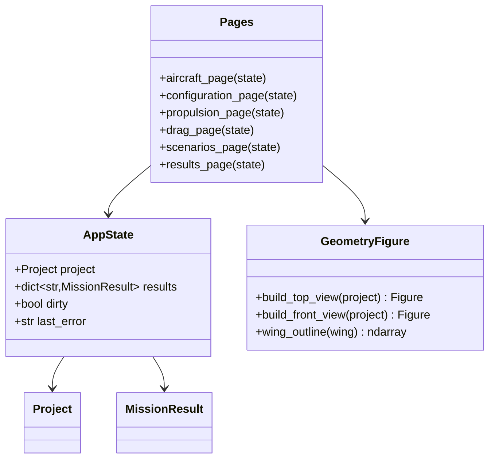

# Streamlit application

## Requirements

- Provide a local web GUI to create, edit, save and load a pre-sizing project, see
  the aircraft geometry, run the evaluation and read the results.
- Boundary: a thin layer over `Project` and `api.evaluate`; no physics in the GUI;
  single user, local.

## Entities

## Approach

1. Application:
   - `streamlit` multipage-like layout with a sidebar (project name, load/upload,
     save/download, Run button, architecture selector) and tabs: Aircraft, Layout &
     masses, Propulsion & battery, Drag sources, Scenarios, Results.
   - State in `st.session_state["state"]` (`AppState`); every widget writes into a
     working copy of the project; validation errors from `__post_init__` displayed
     inline.
2. Forms:
   - Wing/stab trapezes edited with `st.data_editor` (one column per trapeze, max 5),
     units in headers (mm, deg); fuselage and drop-down fields with `st.selectbox`
     fed by the PredimRC labels (read once through the backend when Excel is
     available, else a static fallback list shipped with SPEC-001).
   - Motors/propellers from `default_database()` with filter by role/range; propeller
     "Auto" option shows the selected one after run (REQ-UI-005).
   - Mass items and drag sources as editable tables; scenarios as a segment table per
     scenario + "hover time" shortcut.
3. Geometry preview:
   - Plotly top view: wing trapezes from cumulative lengths, leading-edge offsets
     ("Flèche /BA" in mm), chords; stab at its lever; fuselage rectangle; rotor discs
     at layout positions with propeller diameter; front view with dihedral.
   - Optional PredimRC image: button "Capture PredimRC view" calling
     `export_geometry_image` when Excel is available; shown side by side.
4. Run:
   - `api.evaluate(project)` in a `st.spinner`; Excel session kept in
     `st.cache_resource` (one per app process, closed at shutdown); results cached
     by project hash with `st.cache_data`.
5. Results:
   - KPI tiles: flight time, range, v_endurance, v_range, total mass, margins
     (red when negative); mass breakdown bar; segment table; battery power vs speed
     curve with the two optimal speeds marked.
6. Launch: console script `predimrc-ui` → `streamlit run` on the app module; optional
   extra `[ui]` (`streamlit`, `plotly`).

## Structure

### Inheritance Relationships
1. No inheritance; pages are functions; `AppState` is a dataclass.

### Dependencies
1. Pages depend on `Project` (SPEC-004), `api.evaluate` (SPEC-005),
   `ComponentDatabase` (SPEC-003), `PredimRCWrapper` (SPEC-001, optional).
2. `GeometryFigure` depends on `plotly` and project geometry only (testable without
   Streamlit).

### Layered Architecture
1. Presentation: `ui/app.py`, `ui/pages/*.py`.
2. View-model: `ui/state.py` (AppState, project edits helpers).
3. Rendering helpers: `ui/geometry.py`, `ui/charts.py`.

## Operations

### Create package - `src/predimrc_wrapper/ui/`
1. `state.py`: `AppState`; `new_project(architecture)` from the example projects;
   `apply_table_edits(project, path, dataframe) -> Project` via `with_overrides`.
2. `geometry.py`: `wing_outline(wing) -> ndarray` (x, y polygon of a half wing,
   mirrored), `build_top_view(project) -> go.Figure`, `build_front_view(project)`.
3. `charts.py`: `mass_breakdown(result)`, `power_vs_speed(result)`,
   `segments_table(result)`.
4. `pages/aircraft.py`, `pages/layout.py`, `pages/propulsion.py`, `pages/drag.py`,
   `pages/scenarios.py`, `pages/results.py`: one `render(state)` function each.
5. `app.py`: page config, sidebar, tabs, run handling, error display.
6. `cli.py`: `main()` runs `streamlit run <app.py>`; `[project.scripts]
   predimrc-ui = "predimrc_wrapper.ui.cli:main"`.

### Create tests - `tests/ui/`
1. `test_geometry.py`: reference wing → half-span 912.5 mm (fuselage half-width
   42.5 + Σ trapeze lengths 870, matching PredimRC "Envergure totale" 1825) and
   outline closed;
   rotor count drawn = layout count.
2. `test_state.py`: table edits produce the expected project; save/load from GUI path
   equals API load.
3. `test_app_smoke.py`: `streamlit.testing.v1.AppTest` runs the app with a
   multicopter example project (no Excel) and clicks Run; no exception.

## Norms

1. Labels in French or English decided once (English by default, matching the API);
   units always displayed.
2. No physics or file format logic in pages; only calls to `Project`, `api`, `ui`
   helpers.
3. Long calls inside spinners; errors shown with `st.error`, details in an expander.

## Safeguards

1. Functional: a project saved from the GUI loads identically with `Project.load`.
2. Functional: the GUI runs without Excel for multicopter projects and for editing any
   project; the Run of a wing-borne project without Excel shows a clear message.
3. Performance: editing a field never triggers PredimRC; only Run does.
4. Integration: a single Excel instance per app process.
5. Usability: invalid inputs are reported next to the field and block Run.
